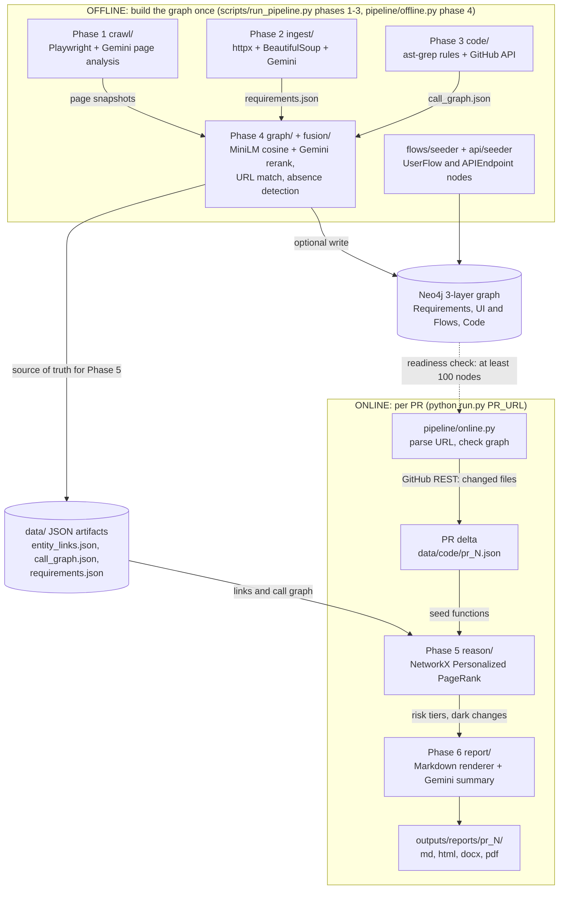
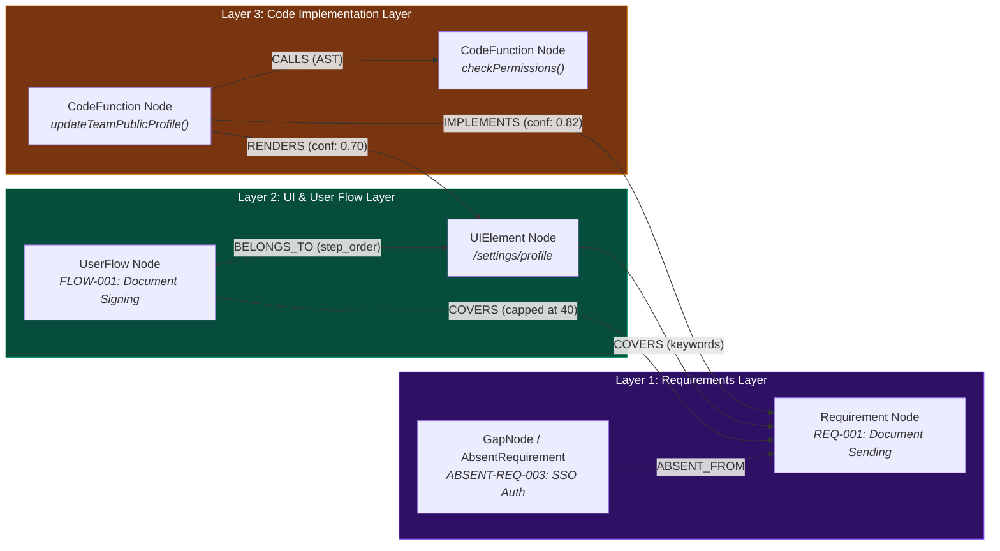

<p align="center">
  
</p>

# CASCADE — Change Analysis for Software Cascade using Dependency Evidence

> *"Understand every consequence before every merge."*


**CASCADE** is an AI-powered Blast Radius Analyzer & Evidence-backed Product Knowledge Graph for explainable Pull Request impact analysis. Give it a GitHub PR URL and it tells QA leads and engineering teams **exactly what to test**: which UI pages are at risk, which product requirements lose coverage, and which changed functions have no traceable path back to any product feature.

**Target app:** [app.documenso.com](https://app.documenso.com) · **Target repo:** [documenso/documenso](https://github.com/documenso/documenso)  
**Presented by:** Harsh Vardhan (*IIIT Nagpur*) · **AI Engineer Assignment:** Testsigma (*July 2026*)  
**Docs:** [the-harsh-vardhan.github.io/CASCADE](https://the-harsh-vardhan.github.io/CASCADE/) · **Live 3D graph:** [cascade-graph-explorer.vercel.app](https://cascade-graph-explorer.vercel.app) · **Walkthrough:** [Loom (9:53)](https://www.loom.com/share/cdab254822bd4cbfbc5ebf0c9c79874e)

## The problem it solves

A code diff says which files changed, but a QA lead needs to know which *product behaviours* to retest. Tracing that by hand across product docs, the live app and the source is slow and error-prone. CASCADE builds one graph that links all three (requirements → UI pages and user flows → code), walks it from the changed functions of a PR, and writes a report a non-engineer can act on.

## What it does

- **Crawls** the live app with Playwright and has Gemini analyse each page into structured UI elements and flows.
- **Ingests** the Documenso product documentation into typed `Requirement` records (272 in the committed extract, across 9 feature areas).
- **Indexes** the source with `ast-grep` rules to get functions, tRPC procedures and a call graph.
- **Resolves** the three layers into `IMPLEMENTS`, `RENDERS`, `COVERS` and `CALLS` edges (sentence-transformer cosine + Gemini reranking), and models *absence* as first-class gap nodes.
- **Reasons per PR** with Personalized PageRank seeded at the changed functions, then writes a QA-readable report (Markdown, HTML, DOCX, PDF) with risk tiers, dark changes and a test checklist.

## Architecture



- **Phase 5** runs [Personalized PageRank](https://en.wikipedia.org/wiki/PageRank) seeded at the changed functions. Impact scores propagate through `CALLS`, `RENDERS`, `IMPLEMENTS` and `COVERS` edges and are classified into HIGH / MEDIUM / LOW risk tiers.
- **LLM calls are bounded to Phases 1, 2, 4 and 6** (page analysis, requirement extraction, entity-resolution reranking, executive summary), all through the key-rotating client in `blast_radius/llm.py`. Phase 5 graph traversal is deterministic.
- Phase 5 reads the JSON artifacts written by Phase 4; Neo4j is an optional persistence and visualisation layer, but `run.py` checks that it holds a populated graph before analysing a PR.

## Results

Real run on [Documenso PR #3046](https://github.com/documenso/documenso/pull/3046) (*fix: tighten permission and validation checks*), from the committed report in [`submission/blast radius report/`](submission/blast%20radius%20report/pr_3046_blast_radius.md):

| Metric | Value |
|---|---|
| Files changed in PR | 29 (all TypeScript) |
| Affected UI pages | 1 (`/settings/profile`) |
| Priority QA test scenarios generated | 6 |
| Dark changes (no graph path to a page or requirement) | 12 |
| Absent requirements flagged | 6 |

The committed graph export ([`data/graph_data.json`](data/graph_data.json)) has 2,396 nodes and 12,790 edges across the three layers. Evaluation notes and known limits (tRPC abstraction gap, stability check) are in the [design document](submission/design%20document/design_document_expanded.md). Full example report: [`blast_radius_report.md`](blast_radius_report.md).

## Screenshots


## Quick Start

**Two steps:** build the graph once, then analyze any PR in seconds.

### Step 1 — Build the knowledge graph (one-time)

```bash
# 1. Clone + install
git clone https://github.com/The-Harsh-Vardhan/CASCADE
cd CASCADE
pip install -e ".[dev]"
playwright install chromium

# 2. Copy env and fill in your credentials
cp .env.example .env
# Open .env and set: GEMINI_API_KEY_1, GITHUB_TOKEN,
#   DOCUMENSO_EMAIL, DOCUMENSO_PASSWORD, NEO4J_PASSWORD

# 3. Start Neo4j
docker compose up -d
# Wait 15 seconds, then confirm:  curl http://localhost:7474

# 4. Clone the Documenso source (needed for static analysis)
git clone https://github.com/documenso/documenso data/repos/documenso

# 5. Validate everything is wired up
python scripts/validate_env.py

# 6. Phases 1-3: crawl, ingest requirements, index code
python scripts/run_pipeline.py --phase 1
python scripts/run_pipeline.py --phase 2
python scripts/run_pipeline.py --phase 3

# 7. Phase 4: resolve entities, build the graph, seed flows and API endpoints
python pipeline/offline.py
```

> `pipeline/offline.py` runs Phase 4 plus the `UserFlow`/`APIEndpoint` seeders; Phases 1–3 go through `scripts/run_pipeline.py` as shown (tracked in [#4](https://github.com/The-Harsh-Vardhan/CASCADE/issues/4)).
>
> **No Documenso account?** `CRAWL_USE_FIXTURE=true` makes Phase 1 read `data/crawl/fixtures/*.json` instead of crawling. That directory is gitignored and not shipped in this repo today, so you would need to supply your own snapshots (also [#4](https://github.com/The-Harsh-Vardhan/CASCADE/issues/4)).

### Step 2 — Analyze a PR

```bash
python run.py https://github.com/documenso/documenso/pull/3046
```

Output (written to `outputs/reports/pr_3046/pr_3046_blast_radius.md` in 4 formats):

```
Analyzing PR #3046 in documenso/documenso
--------------------------------------------------
Graph ready - 2341 nodes loaded.

Fetching PR #3046 from documenso/documenso ...
  29 files changed, 23 TypeScript
  PR delta saved -> data/code/pr_3046.json

Running Phase 5: Blast Radius Reasoning ...
Running Phase 6: Report Rendering ...

[CASCADE] 4 Report Formats (MD, HTML, PDF, DOCX) saved to PR folder -> outputs/reports/pr_3046
--------------------------------------------------
[OK] Blast Radius Analysis complete for PR #3046!
[Output] Deliverables saved to: outputs/reports/pr_3046
   - Markdown: outputs/reports/pr_3046/pr_3046_blast_radius.md
   - HTML:     outputs/reports/pr_3046/pr_3046_blast_radius.html
   - PDF:      outputs/reports/pr_3046/pr_3046_blast_radius.pdf
   - DOCX:     outputs/reports/pr_3046/pr_3046_blast_radius.docx
--------------------------------------------------
```

### Prerequisites

| Tool | Version | Install |
|------|---------|---------|
| Python | 3.11+ | [python.org](https://python.org) |
| Docker | latest | [docker.com](https://docker.com) |
| ast-grep | latest | `brew install ast-grep` or [GitHub releases](https://github.com/ast-grep/ast-grep/releases) |
| Playwright | via pip | `pip install playwright && playwright install chromium` |

> `pip install -e ".[dev]"` installs the Python dependencies declared in `pyproject.toml`.

### Environment variables

Copy `.env.example` → `.env` and fill in:

| Variable | Required | Where to get it |
|---|---|---|
| `GEMINI_API_KEY_1` | ✅ | [aistudio.google.com/app/apikey](https://aistudio.google.com/app/apikey) (`GEMINI_API_KEY_2` to `_5` are rotated on 429s) |
| `GITHUB_TOKEN` | ✅ | GitHub → Settings → Developer settings → Fine-grained tokens (`repo` scope) |
| `DOCUMENSO_EMAIL` | ✅ (for a live crawl) | Free account at [app.documenso.com/signup](https://app.documenso.com/signup) |
| `DOCUMENSO_PASSWORD` | ✅ (for a live crawl) | Same account |
| `NEO4J_URI` | ✅ | `bolt://localhost:7687` (default) |
| `NEO4J_PASSWORD` | ✅ | Must match `docker-compose.yml` → `NEO4J_AUTH` |
| `CRAWL_USE_FIXTURE` | optional | Set `true` to skip live crawl (needs your own fixtures, see above) |

### What "PASS" looks like per phase

| Phase | Success indicator |
|---|---|
| 1 — Crawl | `Phase 1 crawl completed. Captured N page snapshots.` (N ≥ 5) |
| 2 — Ingest | `[ingest] Extracted N requirements` (N ≥ 50) |
| 3 — Code | `[code] Wrote N CodeFunction nodes` + `[code] PR delta: M changed files` |
| 4 — Graph | `[resolve] N IMPLEMENTS links: M LLM-confirmed` (N ≥ 1) |
| Ready for PRs | `run.py` prints `Graph ready - N nodes loaded.` (N ≥ 100 required) |

### Running the offline pipeline phase by phase

```bash
python scripts/run_pipeline.py --phase 1   # Crawl Documenso (Playwright)
python scripts/run_pipeline.py --phase 2   # Ingest requirements (httpx + Gemini)
python scripts/run_pipeline.py --phase 3   # Static analysis (ast-grep + GitHub API)
python scripts/run_pipeline.py --phase 4   # Build graph (entity resolution; Neo4j write is optional)
python pipeline/offline.py                 # Phase 4 + seed UserFlow and APIEndpoint nodes in Neo4j
```

`scripts/run_pipeline.py --all` additionally runs the pre-flight check and Phases 5–6, using the `PR_NUMBER` from `.env`.

## What the report contains

| Section | What it tells QA |
|---|---|
| **TL;DR** | 3-bullet summary — affected pages, dark changes, requirement gaps |
| **Affected UI / Pages** | Pages reachable from changed code, ranked by risk tier |
| **Affected Requirements** | PRD requirements with IMPLEMENTS or COVERS edges to changed functions |
| **Dark Changes** | Changed functions with no graph path — must be reviewed manually |
| **Absent Requirements** | Requirements with no code coverage after this PR |
| **Recommended QA Actions** | Numbered test checklist written for a non-engineer |
| **Changed Files** | Full diff summary with +/- line counts |

## Knowledge graph schema

The system constructs a heterogeneous, 3-layered knowledge graph that bridges the semantic gap between low-level code changes and high-level product requirements.



### The 3 layers

1. **Product Requirements Layer (Top):**
   - **`Requirement` Nodes:** Extracted from Documenso docs (MDX) using `httpx` + Gemini. Categorized into 9 feature areas (`signing`, `sending`, `templates`, `teams`, `webhooks`, `api`, `auth`, `admin`, `notifications`).
   - **`AbsentRequirement` / `GapNode` Nodes:** Requirements flagged as missing UI/code coverage (e.g., auth-gated features or uncrawled endpoints).
2. **UI Structural & User Flow Layer (Middle):**
   - **`UIElement` Nodes:** Web pages and DOM elements captured during Playwright crawling.
   - **`UserFlow` Nodes:** Canonical end-to-end user workflows (e.g., Document Signing, Team Member Invitation).
3. **Code Implementation Layer (Bottom):**
   - **`CodeFunction` Nodes:** Functions, tRPC routes, and React component handlers parsed via `ast-grep` static analysis.

### Core relationships

- **`IMPLEMENTS`** (`CodeFunction` → `Requirement`): Semantic mapping confirmed via hybrid vector embedding + LLM reranking.
- **`RENDERS`** (`CodeFunction` → `UIElement`): Links server/component logic to UI pages.
- **`COVERS`** (`UserFlow` / `UIElement` → `Requirement`): Connects user flows and UI surfaces to satisfied requirements.
- **`CALLS`** (`CodeFunction` → `CodeFunction`): Code-level call graph established via static AST parsing.
- **`BELONGS_TO`** (`UserFlow` → `UIElement`): Step-order mapping for canonical user journeys.

### Interactive 3D graph explorer

An interactive 3D Force Graph visualization is live at [**cascade-graph-explorer.vercel.app**](https://cascade-graph-explorer.vercel.app) (or locally at [`data/graph_explorer.html`](data/graph_explorer.html)). Open it in any modern browser to inspect, search, filter and explore the nodes and cross-layer edges.

## Tech stack

Python 3.11+ · Playwright · Google Gemini (`google-generativeai`, multi-key rotation) · `ast-grep` · `sentence-transformers` (all-MiniLM-L6-v2) · Neo4j 5.14 (Docker) · NetworkX · Pydantic · `httpx` + BeautifulSoup · pytest / ruff / mypy

## Project structure

```
run.py                         # Entry point:  python run.py <github_pr_url>
pipeline/
├── offline.py                 # Root alias for blast_radius.pipeline.offline (graph build + seeders)
└── online.py                  # Per-PR analysis (Phases 5–6)

blast_radius/
├── crawl/                     # Phase 1 — Playwright browser agent
├── ingest/                    # Phase 2 — requirement extractor (httpx + Gemini)
├── code/                      # Phase 3 — ast-grep + GitHub API PR diff
├── graph/                     # Phase 4 — entity resolution + Neo4j writer/schema
├── fusion/                    # Absence detection (absent requirements, dark code, orphaned UI)
├── reason/                    # Phase 5 — PPR blast radius engine
├── report/                    # Phase 6 — report renderer + DOCX exporter
├── flows/                     # UserFlow seed definitions (10 canonical flows)
├── api/                       # APIEndpoint extraction and seeding
├── pipeline/                  # offline.py implementation
├── llm.py                     # Gemini client with key rotation
└── config.py                  # Pydantic-settings config

flows/, api/                   # Root aliases for the blast_radius modules of the same name
rules/                         # ast-grep YAML extraction rules (Phase 3)
templates/                     # Report template
scripts/                       # validate_env.py, run_pipeline.py, per-phase wrappers, debug/ diagnostics
tests/                         # unit/ (no external dependencies) and integration/ (needs Neo4j)

data/                          # Generated pipeline data (mostly gitignored); graph_data.json and
                               #   graph_explorer.html power the 3D explorer
outputs/                       # crawl/ page snapshots, requirements/, reports/ (run.py output)
docs/                          # Images, presentation slides, research notes, GitHub Pages site
submission/                    # Assignment deliverables: SUBMISSION_SUMMARY.md, sample report
                               #   (4 formats), design documents, presentation PDF
```

## Tests

```bash
pytest tests/unit/         # no network, no Neo4j
pytest tests/integration/  # Requires Neo4j running + .env configured
```

Unit tests cover `parse_pr_url`, the `classify` rule engine, `check_graph_ready`, and the Gemini API key rotation pool.

## Design document

[`submission/design document/design_document_expanded.md`](submission/design%20document/design_document_expanded.md) — 21-page expanded edition covering:

- **Agent decomposition** — deterministic vs. LLM-driven phase boundaries and justification
- **Graph schema** — node types, edge types, anchor Cypher query
- **UserFlow modeling** — 10 canonical flows with COVERS + BELONGS_TO edges
- **Confidence handling** — dual-score system (PPR impact × semantic confidence)
- **GapNode design** — modeling absent requirements as first-class graph nodes
- **Eval approach** — two-run stability check, manual recall bounds
- **Scope decisions** — tRPC abstraction gap, crawler depth limits, what comes next

A streamlined edition is also available at [`submission/design document/design_document.md`](submission/design%20document/design_document.md). The full deliverables index (Loom walkthrough, presentation, sample report) is in [`submission/SUBMISSION_SUMMARY.md`](submission/SUBMISSION_SUMMARY.md).

## Troubleshooting

| Error | Fix |
|---|---|
| `ModuleNotFoundError: blast_radius` | `pip install -e .` from repo root |
| `playwright: Executable doesn't exist` | `playwright install chromium` |
| `neo4j.exceptions.ServiceUnavailable` | `docker compose up -d` and wait 15s |
| `Error: Knowledge graph is empty` | Run Phases 1–4 first (Quick Start, Step 1) |
| `Could not parse PR URL` | Must be a GitHub PR URL: `github.com/owner/repo/pull/N` |
| Phase 4 RENDERS = 0 | Auth crawl failed — check `DOCUMENSO_EMAIL` / `DOCUMENSO_PASSWORD` and re-run Phase 1 |
| Phase 1 login timeout | Check credentials, or supply your own fixtures and set `CRAWL_USE_FIXTURE=true` |
| `ValueError: ZERO path matches` | Path format mismatch — check `REPO_CLONE_DIR` in `.env` |

## License

[MIT](LICENSE)
