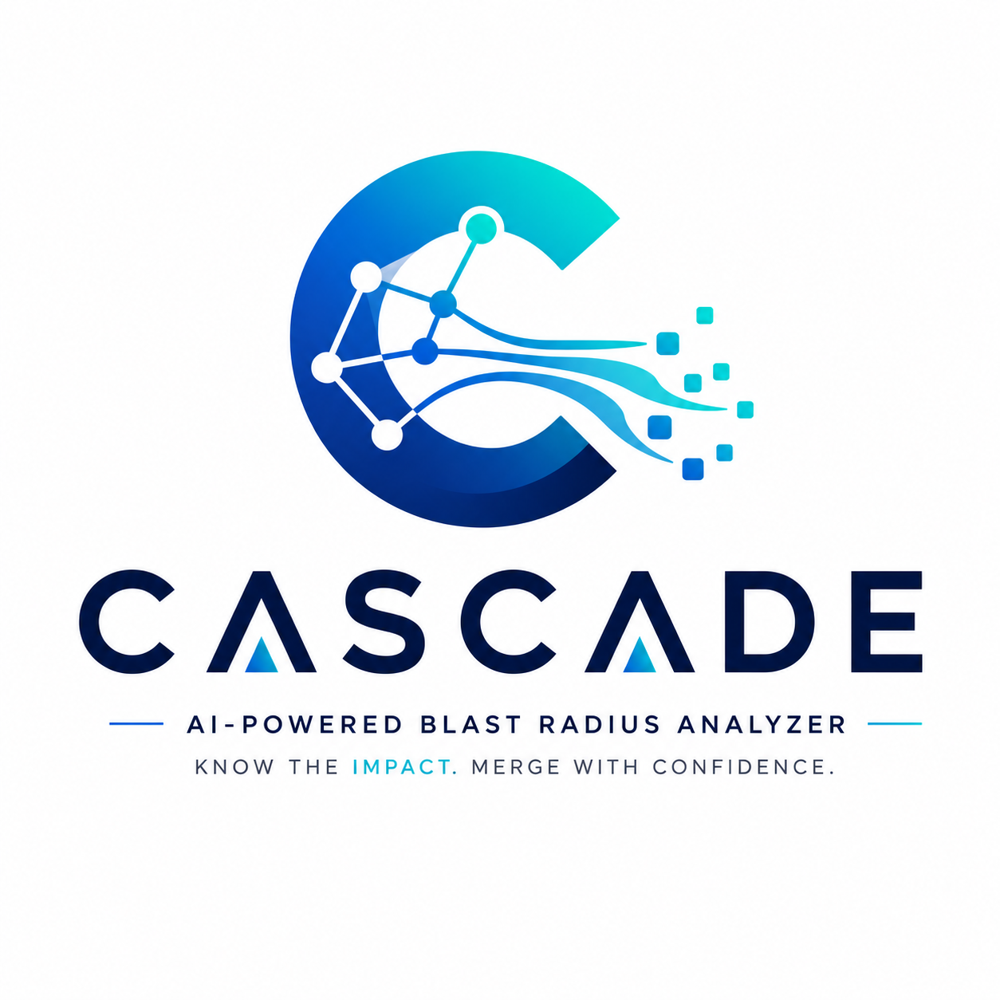
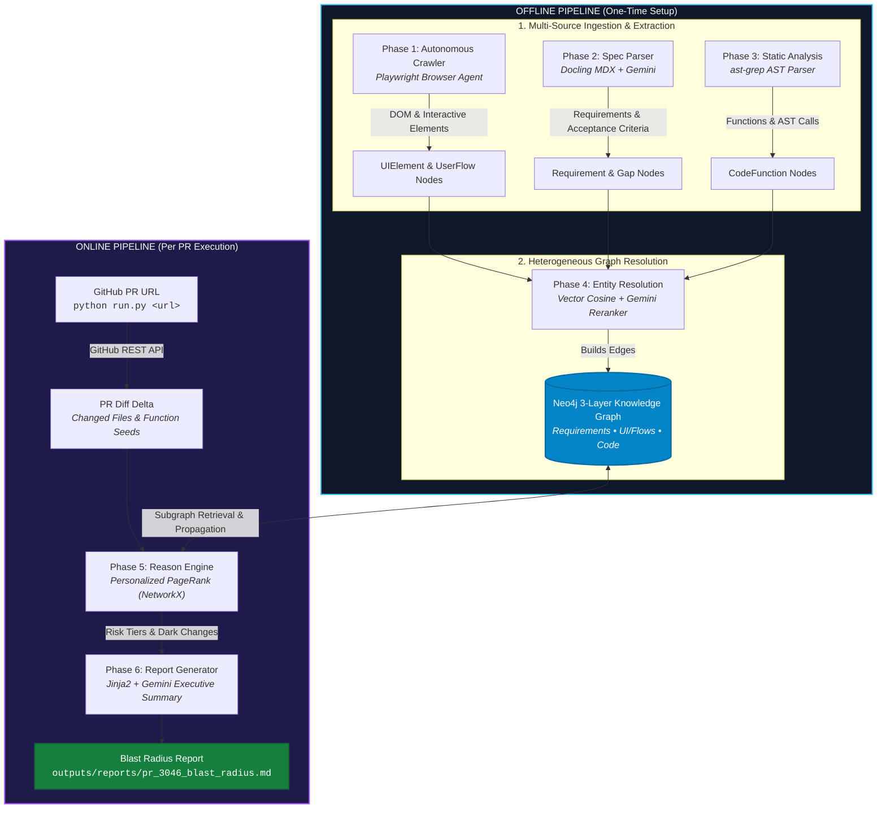
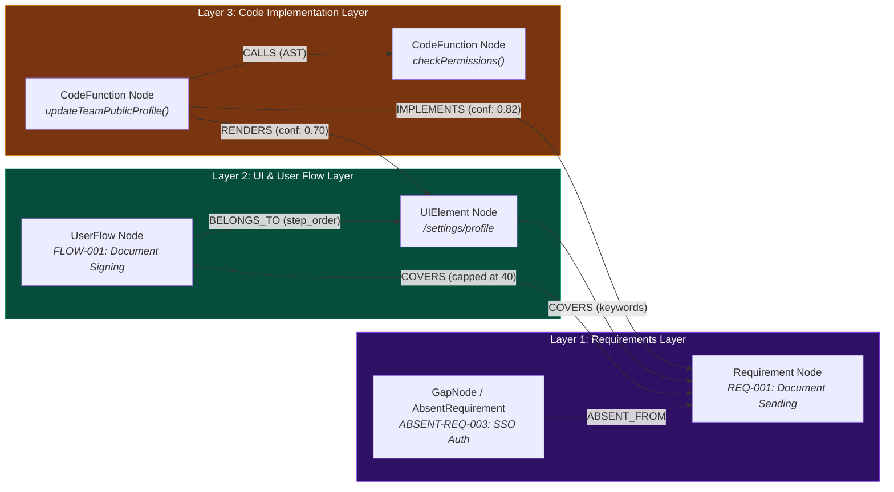
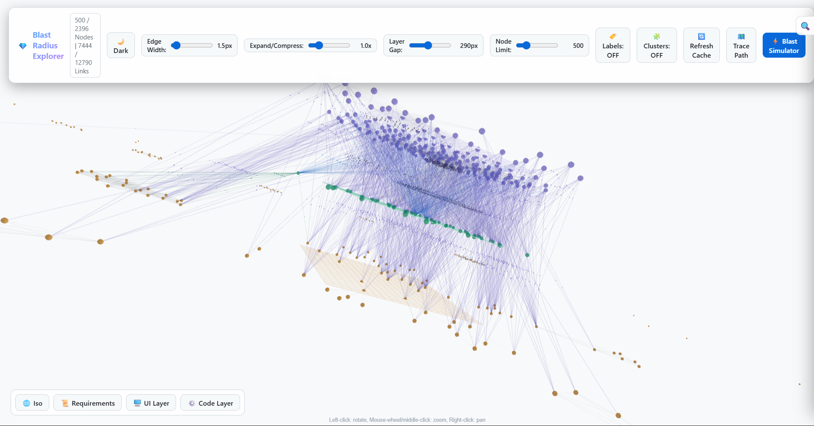

# CASCADE — Change Analysis for Software Cascade using Dependency Evidence

> *“Understand every consequence before every merge.”*

**CASCADE** is an AI-powered Blast Radius Analyzer & Evidence-backed Product Knowledge Graph for explainable Pull Request impact analysis. Given a GitHub PR URL, CASCADE tells QA leads and engineering teams **exactly what to test**: which UI pages are at risk, which product requirements lose coverage, and which changed functions have no traceable path back to any product feature.

**Target app:** [app.documenso.com](https://app.documenso.com) · **Target repo:** [documenso/documenso](https://github.com/documenso/documenso)  
**Presented by:** Harsh Vardhan (*IIIT Nagpur*) · **AI Engineer Assignment:** Testsigma (*July 2026*)

---

## Quick Start

**Two steps:** build the graph once, then analyze any PR in seconds.

### Step 1 — Build the knowledge graph (one-time, ~15 min)

```bash
# 1. Clone + install
git clone https://github.com/The-Harsh-Vardhan/blast-radius-analyzer
cd blast-radius-analyzer
pip install -e ".[dev]"
playwright install chromium

# 2. Copy env and fill in your credentials
cp .env.example .env
# Open .env and set: GEMINI_API_KEY_1, GITHUB_TOKEN,
#   DOCUMENSO_EMAIL, DOCUMENSO_PASSWORD, NEO4J_PASSWORD

# 3. Start Neo4j
docker compose up -d
# Wait 15 seconds, then confirm:  curl http://localhost:7474

# 4. Clone the Documenso source (needed for static analysis)
git clone https://github.com/documenso/documenso data/repos/documenso

# 5. Validate everything is wired up
python scripts/validate_env.py

# 6. Build the graph — crawl → ingest → analyze → build Neo4j
python pipeline/offline.py
```

Expected final line: `Graph ready — N nodes loaded.` (N ≥ 1000)

> **No Documenso account?** Set `CRAWL_USE_FIXTURE=true` in `.env` to use
> pre-committed page snapshots instead of a live crawl.

---

### Step 2 — Analyze a PR

```bash
python run.py https://github.com/documenso/documenso/pull/3046
```

Output (written to `outputs/reports/pr_3046_blast_radius.md` and printed to terminal):

```
Analyzing PR #3046 in documenso/documenso
--------------------------------------------------
[online] Fetching PR diff from GitHub API...
[online] Saved PR delta → data/code/pr_3046.json (29 files)
[reason] Seeds: 32 changed functions
[reason] Affected UI: 1 page | Requirements: 0 | Dark changes: 13
[report] Report written → outputs/reports/pr_3046_blast_radius.md
--------------------------------------------------
Report saved to: outputs/reports/pr_3046_blast_radius.md

# Blast Radius Report — PR #3046
...
```

---

## What the Report Contains

| Section | What it tells QA |
|---|---|
| **TL;DR** | 3-bullet summary — affected pages, dark changes, requirement gaps |
| **Affected UI / Pages** | Pages reachable from changed code, ranked by risk tier |
| **Affected Requirements** | PRD requirements with IMPLEMENTS or COVERS edges to changed functions |
| **Dark Changes** | Changed functions with no graph path — must be reviewed manually |
| **Absent Requirements** | Requirements with no code coverage after this PR |
| **Recommended QA Actions** | Numbered test checklist written for a non-engineer |
| **Changed Files** | Full diff summary with +/- line counts |

See a real example: [`blast_radius_report.md`](blast_radius_report.md)

---

## How It Works



**Phase 5** runs [Personalized PageRank](https://en.wikipedia.org/wiki/PageRank) seeded at the changed functions. Impact scores propagate through `IMPLEMENTS`, `RENDERS`, and `COVERS` edges to produce a risk-ranked list of affected requirements and UI pages.

**LLM calls are bounded to Phases 2, 4, and 6** — requirement extraction, entity-resolution reranking, and executive summary generation. All graph traversal (Phase 5) is deterministic.

---

## Knowledge Graph Architecture & Visualization

The system constructs a heterogeneous, 3-layered knowledge graph in Neo4j that bridges the semantic gap between low-level code changes and high-level product requirements.





### The 3 Layers

1. **Product Requirements Layer (Top):**
   - **`Requirement` Nodes:** Extracted from Documenso PRD/MDX docs using Docling + Gemini. Categorized into 9 feature areas (`signing`, `sending`, `templates`, `teams`, `webhooks`, `api`, `auth`, `admin`, `notifications`).
   - **`AbsentRequirement` / `GapNode` Nodes:** Requirements flagged as missing UI/code coverage (e.g., auth-gated features or uncrawled endpoints).
2. **UI Structural & User Flow Layer (Middle):**
   - **`UIElement` Nodes:** Web pages and DOM elements captured during Playwright crawling.
   - **`UserFlow` Nodes:** Canonical end-to-end user workflows (e.g., Document Signing, Team Member Invitation).
3. **Code Implementation Layer (Bottom):**
   - **`CodeFunction` Nodes:** Functions, tRPC routes, and React component handlers parsed via `ast-grep` static analysis.

### Core Relationships & Graph Edges

- **`IMPLEMENTS`** (`CodeFunction` → `Requirement`): Semantic mapping confirmed via hybrid vector embedding + LLM reranking.
- **`RENDERS`** (`CodeFunction` → `UIElement`): Links server/component logic to UI pages.
- **`COVERS`** (`UserFlow` / `UIElement` → `Requirement`): Connects user flows and UI surfaces to satisfied requirements.
- **`CALLS`** (`CodeFunction` → `CodeFunction`): Code-level call graph established via static AST parsing.
- **`BELONGS_TO`** (`UserFlow` → `UIElement`): Step-order mapping for canonical user journeys.

### Interactive 3D Graph Explorer

An interactive 3D Force Graph visualization is pre-built at [`data/graph_explorer.html`](data/graph_explorer.html). Open this HTML file directly in any modern browser to inspect, search, filter, and interactively explore the 2,300+ nodes and 7,400+ cross-layer edges.

---

## Prerequisites

| Tool | Version | Install |
|------|---------|---------|
| Python | 3.11+ | [python.org](https://python.org) |
| Docker | latest | [docker.com](https://docker.com) |
| ast-grep | latest | `brew install ast-grep` or [GitHub releases](https://github.com/ast-grep/ast-grep/releases) |
| Playwright | via pip | `pip install playwright && playwright install chromium` |

> `pip install -e ".[dev]"` installs all Python dependencies from `pyproject.toml`.

---

## Environment Variables

Copy `.env.example` → `.env` and fill in:

| Variable | Required | Where to get it |
|---|---|---|
| `GEMINI_API_KEY_1` | ✅ | [aistudio.google.com/app/apikey](https://aistudio.google.com/app/apikey) |
| `GITHUB_TOKEN` | ✅ | GitHub → Settings → Developer settings → Fine-grained tokens (`repo` scope) |
| `DOCUMENSO_EMAIL` | ✅ (or use fixture mode) | Free account at [app.documenso.com/signup](https://app.documenso.com/signup) |
| `DOCUMENSO_PASSWORD` | ✅ (or use fixture mode) | Same account |
| `NEO4J_URI` | ✅ | `bolt://localhost:7687` (default) |
| `NEO4J_PASSWORD` | ✅ | Must match `docker-compose.yml` → `NEO4J_AUTH` |
| `CRAWL_USE_FIXTURE` | optional | Set `true` to skip live crawl |

---

## Running the Offline Pipeline (Phase by Phase)

Run `python pipeline/offline.py` to run all 4 phases in sequence. Or run individually:

```bash
python scripts/run_pipeline.py --phase 1   # Crawl Documenso (Playwright)
python scripts/run_pipeline.py --phase 2   # Ingest requirements (Docling + Gemini)
python scripts/run_pipeline.py --phase 3   # Static analysis (ast-grep + GitHub API)
python scripts/run_pipeline.py --phase 4   # Build Neo4j graph (entity resolution)
```

### What "PASS" looks like per phase

| Phase | Success indicator |
|---|---|
| 1 — Crawl | `Phase 1 crawl completed. Captured N page snapshots.` (N ≥ 5) |
| 2 — Ingest | `[ingest] Extracted N requirements` (N ≥ 50) |
| 3 — Code | `[code] Wrote N CodeFunction nodes` + `[code] PR delta: M changed files` |
| 4 — Graph | `[resolve] N IMPLEMENTS links: M LLM-confirmed` (N ≥ 1) |
| Graph ready | `Graph ready — N nodes loaded.` (N ≥ 1000) |

---

## Running Without a Documenso Account

Set `CRAWL_USE_FIXTURE=true` in `.env`. The pipeline reads from pre-committed page
snapshots in `data/crawl/fixtures/` — settings page, document list, signing flow.
This is enough to demonstrate Phases 4–6 without credentials.

> RENDERS edge coverage will be lower than a full auth crawl, but the blast radius
> analysis (Phases 5–6) runs identically.

---

## Project Structure

```
run.py                         # Entry point:  python run.py <github_pr_url>
pipeline/
├── offline.py                 # One-time graph build (Phases 1–4)
└── online.py                  # Per-PR analysis (Phases 5–6)

blast_radius/
├── crawl/                     # Phase 1 — Playwright browser agent
├── ingest/                    # Phase 2 — Docling + Gemini requirement extractor
├── code/                      # Phase 3 — ast-grep + GitHub API PR diff
├── graph/                     # Phase 4 — Neo4j schema + entity resolution
├── reason/                    # Phase 5 — PPR + DFS blast radius engine
├── report/                    # Phase 6 — Jinja2 report renderer
├── llm.py                     # Gemini client with key rotation
└── config.py                  # Pydantic-settings config

data/                          # All gitignored except fixtures
├── crawl/fixtures/            # Pre-committed page snapshots (fixture mode)
├── code/                      # CodeFunction + PRDelta JSON
├── requirements/              # Extracted requirements JSON
├── reports/                   # Phase 5/6 intermediate reports
└── repos/documenso/           # Cloned Documenso source (for ast-grep)

outputs/reports/               # run.py final output — pr_{N}_blast_radius.md

docs/
├── design_document.md         # 8–12 page design document (deliverable)
└── blast_radius_report_final.md

scripts/
├── validate_env.py            # Pre-flight checks (run before pipeline)
├── run_pipeline.py            # Phase-by-phase runner
├── fix_absent_requirements.py # Neo4j AbsentRequirement cleanup utility
└── debug/                     # Internal diagnostic scripts (not for end users)

templates/                     # Jinja2 report templates
tests/
├── unit/                      # 34 fast tests — no external dependencies
└── integration/               # Requires live Neo4j
rules/                         # ast-grep YAML extraction rules
```

---

## Tests

```bash
pytest tests/unit/         # 34 tests, ~0.3s — no network, no Neo4j
pytest tests/integration/  # Requires Neo4j running + .env configured
```

All 34 unit tests cover `parse_pr_url`, the `classify` rule engine,
`check_graph_ready`, and the Gemini API key rotation pool.

---

## Design Document

[`docs/design_document.md`](docs/design_document.md) — 8–12 pages covering:

- **Agent decomposition** — deterministic vs. LLM-driven phase boundaries and justification
- **Graph schema** — 5 node types, 6 edge types, anchor Cypher query
- **UserFlow modeling** — 10 canonical flows with COVERS + BELONGS_TO edges
- **Confidence handling** — dual-score system (PPR impact × semantic confidence)
- **GapNode design** — modeling absent requirements as first-class graph nodes
- **Eval approach** — two-run stability check, manual recall bounds
- **Scope decisions** — tRPC abstraction gap, crawler depth limits, what comes next

---

## Troubleshooting

| Error | Fix |
|---|---|
| `ModuleNotFoundError: blast_radius` | `pip install -e .` from repo root |
| `playwright: Executable doesn't exist` | `playwright install chromium` |
| `neo4j.exceptions.ServiceUnavailable` | `docker compose up -d` and wait 15s |
| `Error: Knowledge graph is empty` | Run `python pipeline/offline.py` first |
| `Could not parse PR URL` | Must be a GitHub PR URL: `github.com/owner/repo/pull/N` |
| Phase 4 RENDERS = 0 | Auth crawl failed — set `CRAWL_USE_FIXTURE=true` |
| Phase 1 login timeout | Set `CRAWL_USE_FIXTURE=true` |
| `ValueError: ZERO path matches` | Path format mismatch — check `REPO_CLONE_DIR` in `.env` |

---

## License

MIT
