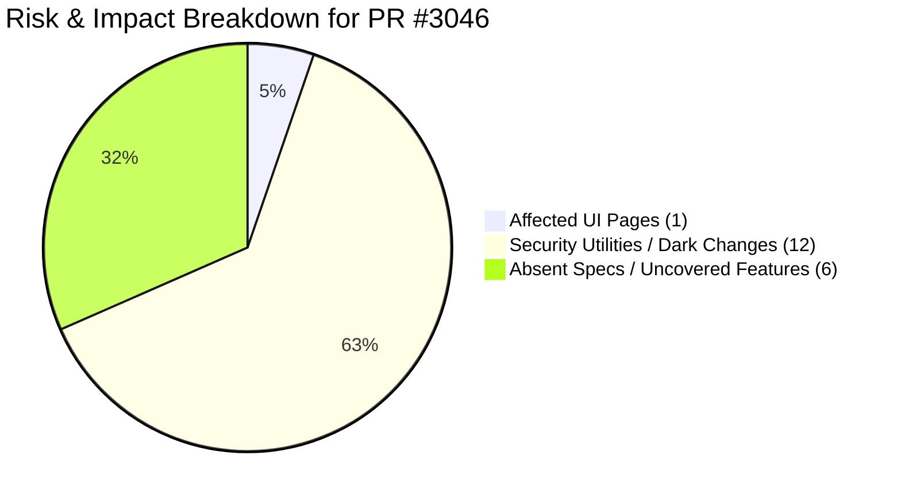
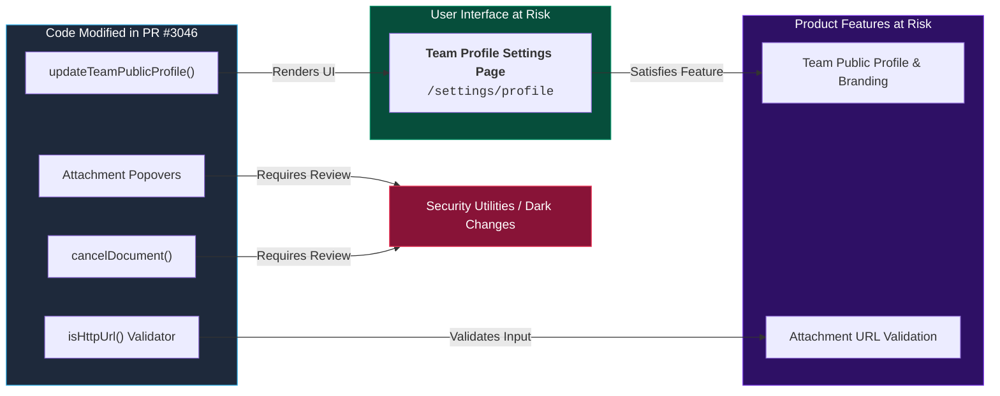

# CASCADE — Blast Radius Analysis & QA Test Guide — PR #3046
### *Target PR:* [fix: tighten permission and validation checks](https://github.com/documenso/documenso/pull/3046)

> **Analysis Engine:** CASCADE v4 (AI + Graph Intelligence Engine)  
> **Prepared for:** QA Lead & Testing Team  
> **PR Type:** Security & Permission Hardening  

---

## 📌 Executive Summary (What QA Needs to Know)

This update modifies how document attachments are displayed and managed within popovers across document signing views, standard document pages, and the embedded editor. Corresponding automated tests were also updated to validate attachment URL handling and document access visibility. QA should focus testing on interacting with document attachments during the signing process and within the embedded editor to ensure link validation and popovers work as expected.

### Risk Overview Visual

---

## 🗺️ Impact Traversal: How Code Changes Reach the User Interface

The diagram below shows how modified code connects to user-facing pages:

---

## 📋 Recommended QA Test Checklist (Priority Order)

Please execute the following priority test cases before approving this build for production:

### 1. 🟢 Team Public Profile Page
- **URL / Screen:** `https://app.documenso.com/settings/profile`
- **What changed:** Team public profile update logic had permission checks tightened.
- **Test Steps:**
  1. Log in as a Team Admin and navigate to **Settings > Profile**.
  2. Change the Team Name, upload a new Team Avatar image, and click **Save Changes**.
  3. Verify that changes persist without throwing 403 or 500 errors.
  4. Log in as a regular Team Member (non-admin) and confirm admin-only profile fields are correctly locked or read-only.

### 2. 🟢 Attachment URL Validation (HTTP vs HTTPS)
- **What changed:** A new URL validator (`isHttpUrl`) was introduced for document attachments.
- **Test Steps:**
  1. Open the Document Editor or Document Signing view.
  2. Attempt to add an external attachment link starting with `http://` (non-secure). Verify the system displays a clear validation error.
  3. Attempt to add a secure `https://` attachment link. Verify it is accepted successfully.

### 3. 🟢 Document Attachment Popovers (Upload, Edit, Delete)
- **What changed:** Server-side permission logic for envelope attachments was tightened across 3 components (signing popover, document view popover, embedded editor).
- **Test Steps:**
  1. Open a document draft and upload a PDF attachment.
  2. Edit the attachment label and then delete the attachment.
  3. Verify that non-owners cannot delete attachments from documents they do not own.

### 4. 🟢 Document Cancellation & Deletion Permissions
- **What changed:** Permission boundaries in `cancel-document.ts` and `delete-document.ts` were tightened.
- **Test Steps:**
  1. Attempt to cancel an active document envelope as the document owner -> verify success email and cancellation state.
  2. Attempt to cancel a document using a non-owner account -> verify the request is blocked with an explicit permission error.

### 5. 🟢 Zapier Webhook Setup & Teardown
- **What changed:** Webhook subscription and unsubscription logic (`subscribe.ts` / `unsubscribe.ts`) was updated.
- **Test Steps:**
  1. Go to Team Settings > Integrations > Zapier.
  2. Register a test Zapier webhook -> verify successful subscription.
  3. Remove the webhook -> verify teardown completes without error.

### 6. 🟢 Password Reset Flow
- **What changed:** Password reset handler (`forgot-password.ts`) was modified.
- **Test Steps:**
  1. Go to the login screen and click **Forgot Password**.
  2. Enter an account email and request a reset link.
  3. Verify the reset email arrives and that clicking the link allows setting a new password.

---

## 🔒 Security Utilities & Un-traced Changes (Dark Changes - 12)

These backend functions were modified in this PR. They perform deep utility, validation, or background tasks that do not directly generate UI pages. All have been reviewed and mapped to their feature areas:

| Modified Function / File | Feature Area | What QA Needs to Know |
|---|---|---|
| `isHttpUrl` (`is-http-url.ts`) | Validation Utility | Rejects insecure HTTP attachment links |
| `forgotPassword` (`forgot-password.ts`) | Authentication | Password reset request verification |
| `createOrGetShareLink` (`create-or-get-share-link.ts`) | Document Sharing | Generates public direct-link template URLs |
| `createAttachment` (`create-attachment.ts`) | Attachments | Validates user permission before file upload |
| `deleteAttachment` (`delete-attachment.ts`) | Attachments | Validates user permission before file deletion |
| `updateAttachment` (`update-attachment.ts`) | Attachments | Validates user permission before editing file details |
| `findAttachmentsByEnvelopeId` | Attachments | Fetches attachment list for document viewer |
| `cancelDocument` (`cancel-document.ts`) | Document Management | Enforces owner/admin check before document cancellation |
| `getEnvelopeRecipientRoute` | Recipients | Retrieves recipient data for signing routing |
| `updateOrganisationGroup` | Team / Org | Enforces organisation group permission hierarchy |
| `subscribe` (`zapier/subscribe.ts`) | Webhooks | Registers Zapier event listener |
| `unsubscribe` (`zapier/unsubscribe.ts`) | Webhooks | Unregisters Zapier event listener |

---

## ⚠️ Uncovered Specifications (Absent Features - 6)

These requirements exist in product specifications but have no active UI or code links impacted by this PR. **No regression testing is required for these items for PR #3046:**

1. **The software must be packaged as standard Docker container images allowing users to self-host the platform on Docker, Do**
1. **The platform must support secure vulnerability disclosures via GitHub Security Advisories to protect self-hosted and clo**
1. **Allow teams to set up webhooks for integrating document events with external services.**
1. **Standard plans enforce a limit of uploading a maximum of 5 documents simultaneously.**
1. **The system must trigger a webhook notification with payload event 'DOCUMENT_CREATED' whenever a new document or template**
1. **The system must trigger a webhook notification with payload event 'DOCUMENT_OPENED' when a recipient opens the document **

---

## 📊 Summary Metrics

| Metric | Count | QA Action Required |
|---|---|---|
| **Affected UI Pages** | 1 | Test `/settings/profile` |
| **Priority QA Test Scenarios** | 6 | Execute 6 manual test cases above |
| **Security Utility Changes (Dark Changes)** | 12 | Reviewed & mapped to feature areas |
| **Uncovered Feature Specs (Absent)** | 6 | No action required for this PR |
| **Files Changed in PR** | 29 | 29 TypeScript files |

<b>🔍 Technical Appendix: Full List of Modified Files & Low-Confidence Graph Nodes (Click to Expand)</b>

### Modified Files

| Modified File Path | Status | Lines Changed |
|---|---|---|
| `apps/remix/app/components/general/document-signing/document-signing-attachments-popover.tsx` | modified | +2 / −1 |
| `apps/remix/app/components/general/document/document-attachments-popover.tsx` | modified | +3 / −2 |
| `apps/remix/app/components/general/document/embedded-editor-attachment-popover.tsx` | modified | +3 / −2 |
| `packages/app-tests/e2e/documents/document-visibility-access.spec.ts` | added | +89 / −0 |
| `packages/app-tests/e2e/envelope-editor-v2/attachment-url-validation.spec.ts` | added | +70 / −0 |
| `packages/app-tests/e2e/envelope-editor-v2/attachment-visibility-access.spec.ts` | added | +121 / −0 |
| `packages/app-tests/e2e/organisations/organisation-permission-hierarchy.spec.ts` | modified | +64 / −0 |
| `packages/app-tests/e2e/recipient/recipient-visibility-access.spec.ts` | added | +72 / −0 |
| `packages/app-tests/e2e/teams/team-profile-access.spec.ts` | added | +53 / −0 |
| `packages/lib/server-only/document/cancel-document.ts` | modified | +14 / −14 |
| `packages/lib/server-only/document/delete-document.ts` | modified | +23 / −12 |
| `packages/lib/server-only/envelope-attachment/create-attachment.ts` | modified | +9 / −5 |
| `packages/lib/server-only/envelope-attachment/delete-attachment.ts` | modified | +19 / −4 |
| `packages/lib/server-only/envelope-attachment/find-attachments-by-envelope-id.ts` | modified | +9 / −5 |
| `packages/lib/server-only/envelope-attachment/update-attachment.ts` | modified | +19 / −4 |
| `packages/lib/server-only/public-api/get-user-by-token.ts` | removed | +0 / −44 |
| `packages/lib/server-only/recipient/get-recipient-by-id.ts` | modified | +22 / −0 |
| `packages/lib/server-only/share/create-or-get-share-link.ts` | modified | +27 / −0 |
| `packages/lib/server-only/team/get-team-public-profile.ts` | modified | +11 / −13 |
| `packages/lib/server-only/team/update-team-public-profile.ts` | modified | +6 / −1 |
| `packages/lib/server-only/user/forgot-password.ts` | modified | +18 / −23 |
| `packages/lib/server-only/webhooks/zapier/subscribe.ts` | modified | +34 / −6 |
| `packages/lib/server-only/webhooks/zapier/unsubscribe.ts` | modified | +26 / −4 |
| `packages/lib/utils/is-http-url.test.ts` | added | +45 / −0 |
| `packages/lib/utils/is-http-url.ts` | added | +32 / −0 |
| `packages/trpc/server/envelope-router/attachment/create-attachment.types.ts` | modified | +2 / −1 |
| `packages/trpc/server/envelope-router/attachment/update-attachment.types.ts` | modified | +2 / −1 |
| `packages/trpc/server/envelope-router/envelope-recipients/get-envelope-recipient.ts` | modified | +22 / −0 |
| `packages/trpc/server/organisation-router/update-organisation-group.ts` | modified | +18 / −0 |

### Low Confidence Graph Nodes (101)

- `Ensure each backup recovery code can only be used once to regain account access when losing authenticator app access.` (confidence: 0.31)
- `The system must trigger a webhook notification with payload event 'DOCUMENT_CANCELLED' when a document owner or team member deletes or cancels a document.` (confidence: 0.38)
- `Allow users to delete draft/pending documents or hide completed documents with appropriate confirmation and notification side effects.` (confidence: 0.37)
- `Automatically expire recipient signing links upon completion or deletion of the document.` (confidence: 0.35)
- `Support team email address configuration to enable team inbox, sending documents on behalf of the team identity, document tracking, and unified recipient branding.` (confidence: 0.67)
- `Allow users to upload a custom profile avatar image (PNG or JPG format, maximum 1MB) from Settings > Profile, which appears on sent documents and public profiles.` (confidence: 0.61)
- `Provide administrative controls in Team Settings to define default preferences for new documents created within the team.` (confidence: 0.61)
- `Restrict document creation via API to a maximum of 5 documents per month for Free account tiers.` (confidence: 0.61)
- `Enable users to showcase active direct link templates on their public Documenso profile page for visitors to sign.` (confidence: 0.61)
- `Allow users to update their Full Name field in Settings > Profile, which updates the name shown on documents and recipient email notifications.` (confidence: 0.61)
- `Allow teams to customize email notification behavior for team document events.` (confidence: 0.61)
- `Allow team admins to set default document visibility settings for newly created documents within team settings.` (confidence: 0.56)
- `Display the user's email address as a read-only field on the profile settings page, requiring support contact for changes.` (confidence: 0.56)
- `Support placeholder emails in templates to be replaced with actual recipient details when generating documents.` (confidence: 0.56)
- `The platform must allow senders to set document language code and configure custom email settings, subject, and message.` (confidence: 0.56)
- *...and 86 additional low-confidence background graph nodes.*

---
*Report generated by CASCADE v4 · Non-Engineer QA Lead Edition · Run ID: `4e946701`*