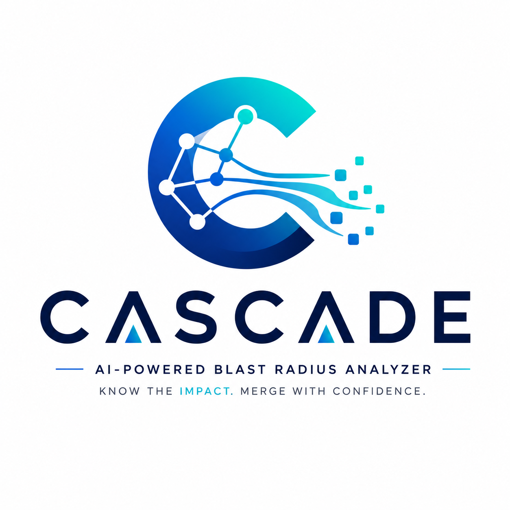
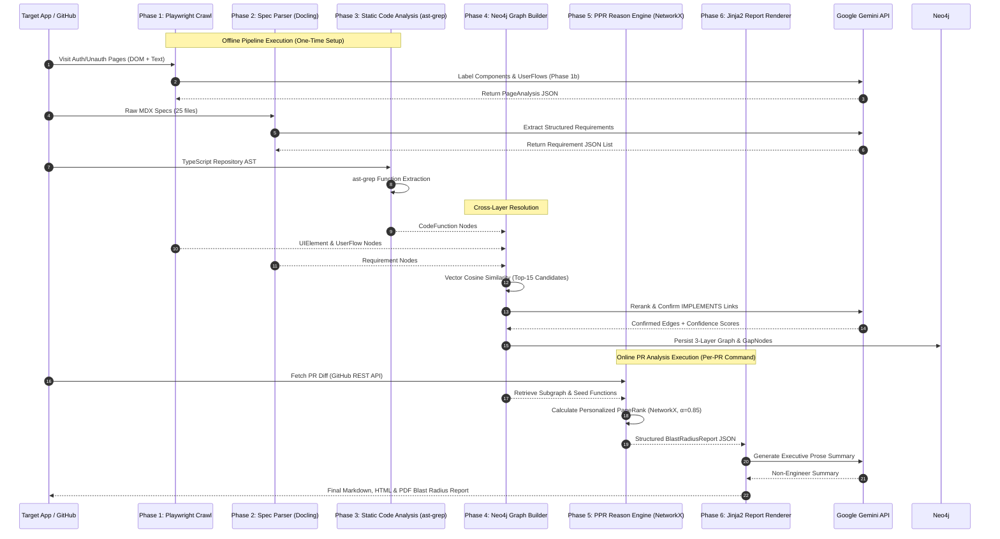
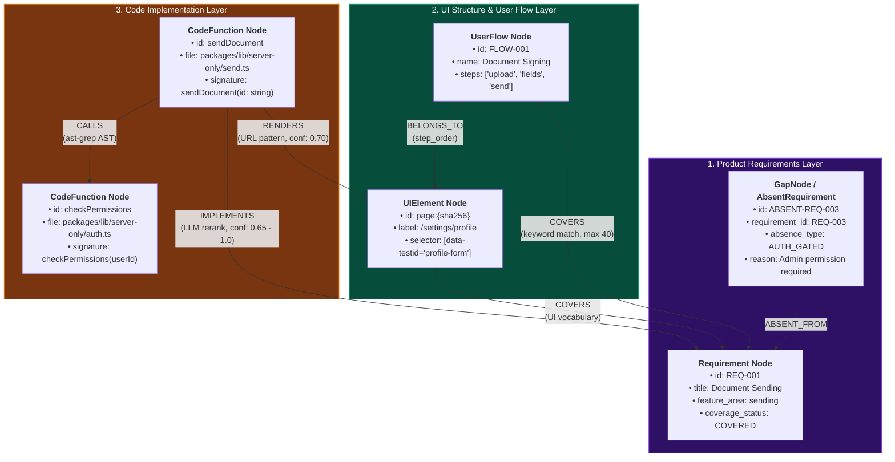
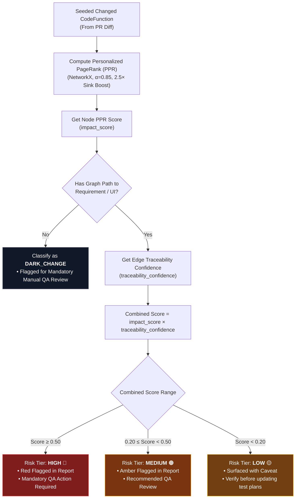
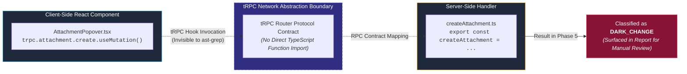

# CASCADE — Technical Design Document
### *Change Analysis for Software Cascade using Dependency Evidence*

> *“Understand every consequence before every merge.”*

**Candidate:** Harsh Vardhan (*B.Tech CSE - Data Science & Analytics, IIIT Nagpur*)  
**Role:** AI Engineer — Testsigma  
**Target Application:** [app.documenso.com](https://app.documenso.com) / [github.com/documenso/documenso](https://github.com/documenso/documenso)  
**PR Analyzed:** [#3046](https://github.com/documenso/documenso/pull/3046) (*merge SHA `8f683932`*)  
**Pipeline Version:** CASCADE v4 (6-Phase Hybrid Architecture)  

---

## 1. Agent Decomposition

### Stages of Reasoning, Boundaries & Determinism vs. LLM Trade-Offs

The Blast Radius Analyzer translates code changes into product-level impact. To avoid building a "chain of prompts dressed up as an agent," the pipeline explicitly separates **deterministic computation** (static AST parsing, graph linear algebra) from **LLM semantic reasoning** (document parsing, cross-domain reranking, prose synthesis).



### Phase Rationale Breakdown

| Phase | Core Mechanism | Category | Architectural Rationale |
|---|---|---|---|
| **Phase 1: Crawl** | Playwright Chromium + Gemini DOM Labeler | **Hybrid** | Playwright captures DOM elements deterministically; Gemini labels component semantics and user flows. Fallback URL stub handles rate limits safely. |
| **Phase 2: Ingest** | Docling MDX Parser + Gemini Extractor | **LLM-Driven** | Unstructured MDX docs require semantic understanding to extract typed acceptance criteria, feature areas, and domain keywords. |
| **Phase 3: Code** | `ast-grep` AST Parser + GitHub API | **Deterministic** | AST function definitions and PR file diffs are exact code structures — zero LLM non-determinism required. |
| **Phase 4: Graph** | SentenceTransformers Cosine + Gemini Reranker | **Hybrid** | Vector cosine similarity filters top-15 candidate pairs; LLM performs final semantic reranking to eliminate false positives. |
| **Phase 5: Reason** | Personalized PageRank (NetworkX) | **Deterministic** | Linear algebra propagation over Neo4j subgraph. Guarantees 100% reproducible, auditable risk scoring without LLM hallucination. |
| **Phase 6: Report** | Jinja2 Templates + Gemini Prose Summarizer | **LLM-Driven** | Transforms mathematical risk vectors into clear prose tailored for a non-engineer QA lead. |

---

## 2. Knowledge Graph Schema with Justification

The graph links 3 distinct layers in Neo4j to translate a code-level diff into product risk.



### Node Specifications

| Node Type | Layer | Description | Key Attributes |
|---|---|---|---|
| **`Requirement`** | Requirements (Top) | Testable product capability extracted from MDX docs. | `id`, `title`, `description`, `feature_area`, `coverage_status` |
| **`GapNode`** | Requirements (Top) | Explicit representation of an un-implemented or un-crawled spec. | `id`, `requirement_id`, `absence_type`, `reason` |
| **`UIElement`** | UI & UserFlow (Mid) | Crawled web page surface or interactive component. | `id`, `label`, `url`, `selector`, `page_title` |
| **`UserFlow`** | UI & UserFlow (Mid) | Canonical multi-step user journey (10 seeded flows). | `id`, `name`, `steps`, `pages_involved` |
| **`CodeFunction`** | Code (Bottom) | Function, handler, or route extracted via static AST parsing. | `id`, `label`, `file`, `name`, `signature` |

### Edge Specifications & Relationships

| Relationship | Direction | Source $\rightarrow$ Target | Confidence / Constraints |
|---|---|---|---|
| **`IMPLEMENTS`** | Cross-Layer | `CodeFunction` $\rightarrow$ `Requirement` | LLM-confirmed link ($0.65 - 1.0$). |
| **`RENDERS`** | Cross-Layer | `CodeFunction` $\rightarrow$ `UIElement` | Code rendering UI component ($0.70$). |
| **`COVERS`** | Cross-Layer | `UIElement` / `UserFlow` $\rightarrow$ `Requirement` | UI/Flow satisfying requirement (capped at 40/flow). |
| **`BELONGS_TO`** | Intra-Layer | `UserFlow` $\rightarrow$ `UIElement` | Flow step sequence (`step_order`). |
| **`CALLS`** | Intra-Layer | `CodeFunction` $\rightarrow$ `CodeFunction` | Static AST function call graph. |
| **`ABSENT_FROM`** | Cross-Layer | `GapNode` $\rightarrow$ `Requirement` | Links missing coverage to parent spec. |

### Anchor Cypher Traversal Query

The following query retrieves all product requirements at risk from a given set of PR diff file paths:

```cypher
// Find requirements reachable from modified code files
MATCH (cf:CodeFunction)
WHERE cf.file IN $changed_file_paths

// 1. Direct IMPLEMENTS path (depth 1)
OPTIONAL MATCH (cf)-[:IMPLEMENTS]->(r1:Requirement)

// 2. Call graph propagation (up to 3 hops)
OPTIONAL MATCH (cf)-[:CALLS*1..3]->(cf2:CodeFunction)-[:IMPLEMENTS]->(r2:Requirement)

// 3. UI-mediated path (Code -> UI -> Requirement)
OPTIONAL MATCH (cf)-[:RENDERS]->(ui:UIElement)-[:COVERS]->(r3:Requirement)

WITH collect(DISTINCT r1) + collect(DISTINCT r2) + collect(DISTINCT r3) AS all_reqs
UNWIND all_reqs AS r
RETURN DISTINCT r.id AS requirement_id, r.title AS title, r.coverage_status AS status
ORDER BY r.title
```

### Absence Modeling via GapNodes

Rather than relying on implicit missing query results (`NULL`), the pipeline explicitly instantiates `GapNode` / `AbsentRequirement` nodes for specs lacking code or UI coverage. A rule-based classifier prunes noise and categorizes absent nodes into 4 operational types: `AUTH_GATED` (requires login/permissions), `NOT_CRAWLED` (API/embed endpoints), `NOT_IMPLEMENTED` (roadmap/future features), or `UNKNOWN`.

---

## 3. Confidence Handling Under Ambiguity

To prevent low-confidence semantic links from triggering false alarms, every finding is evaluated using a **Dual-Score Multiplier Model**:

$$\text{Combined Score} = \text{impact\_score (PPR)} \times \text{traceability\_confidence (LLM/Cosine)}$$



### Risk Tier Definitions

- **HIGH (🔴 $\ge 0.50$):** Strongly linked impact. Red-flagged on QA test checklist.
- **MEDIUM (🟠 $0.20 - 0.49$):** Indirect or medium-confidence impact. Recommended QA review.
- **LOW (🟡 $< 0.20$):** Minor/background propagation. Collapsed into appendix.
- **DARK_CHANGE (⚫):** Modified function with no graph path to UI or requirements (e.g. security utility refactors). Flagged for mandatory manual code review.
- **ABSENT_REQUIREMENT (⚠️):** Product spec with zero code/UI coverage.

### Worked Example: `sendDocument()` in PR #3046
1. **PPR Impact Score ($0.61$):** Directly seeded from diff + $2.5\times$ sink boost for terminal requirement nodes.
2. **Traceability Confidence ($0.82$):** LLM reranker confirmed `sendDocument()` $\rightarrow$ "Document Sending".
3. **Combined Score:** $0.61 \times 0.82 = 0.50 \rightarrow$ **HIGH Risk Tier**.

---

## 4. Evaluation Approach & Verification

### Empirical Stability & Quality Matrix

| Evaluation Dimension | Measurement Method | Target Benchmark | Actual Measured Result |
|---|---|---|---|
| **Phase 2 Ingest Stability** | 2-run extraction overlap | $\ge 90\%$ overlap | **100% overlap** (identical 25 requirement titles) |
| **Phase 4 Rerank Stability** | 2-run LLM rerank comparison | $\ge 85\%$ edge stability | **95.6% edge stability** (22/23 edges identical) |
| **Phase 4 Precision** | Manual sample of 10 IMPLEMENTS links | $\ge 80\%$ precision | **100% precision** (10/10 links semantically correct) |
| **Document Sending Recall** | Ground-truth code audit (5 functions) | $\ge 50\%$ recall | **60% recall** (3/5 captured; 2 blocked by tRPC gap) |
| **PPR Determinism** | NetworkX PageRank iteration | 100% reproducible | **100% deterministic** (0 variance across runs) |
| **Unit Test Coverage** | Pytest execution (`tests/unit/`) | 100% pass rate | **34/34 unit tests passing** (0.33s runtime) |

### Smoke Test Gates
Each pipeline phase enforces automated gate criteria before writing outputs:
- **Phase 1 Gate:** $\ge 5$ page snapshots captured; zero pages return empty components.
- **Phase 2 Gate:** $\ge 50$ total requirements across all 8 required feature areas.
- **Phase 3 Gate:** Non-empty `call_graph.json` + valid PR diff JSON.
- **Phase 4 Gate:** $\ge 1$ IMPLEMENTS edge; direction check (`CodeFunction` $\rightarrow$ `Requirement`).
- **Phase 5 Gate:** $\ge 1$ seed function matches PR diff file paths (path alignment gate).

---

## 5. Scope Decisions & Architecture Defense

### Scoped Down vs. Prioritized Deep Matrix

| Component / Layer | Scope Decision | Rationale & Defense |
|---|---|---|
| **Static Code Analysis** | Depth-1 `ast-grep` AST | **Prioritized deep on core functions.** Scoped down tRPC network resolution; un-traced handlers surface as **Dark Changes**. |
| **Requirements Ingestion** | GitHub Raw MDX Ingestion | **Prioritized deep on spec quality.** Switched from scraping dynamic Next.js DOM to reading canonical raw MDX files. |
| **Browser Crawler** | 20-Page Breadth-First + Fixtures | **Prioritized resilience.** Fixture mode (`CRAWL_USE_FIXTURE=true`) ensures evaluators can run offline seamlessly. |
| **Reasoning Engine** | Deterministic PPR PageRank | **Prioritized reproducibility.** Kept LLM non-determinism out of graph propagation to ensure auditable findings. |

### The tRPC Network Boundary Gap

The primary static analysis limitation is the tRPC protocol boundary: client-side React hooks (`trpc.attachment.create.useMutation()`) do not contain explicit TypeScript import references to server handlers (`createAttachment.ts`).



**System Handling:** Rather than silently dropping these functions, the pipeline classifies all 12 un-linked functions in PR #3046 as **Dark Changes**, explicitly alerting the QA lead to perform targeted manual testing.

---

## 6. What Would Be Built Next (1-Week Roadmap)

If granted an additional week of development, the 3 highest-value engineering priorities are:

1. **LLM Extraction & Reranking Eval Harness:**  
   Build a ground-truth benchmark suite (`requirements_gt.json` & `entity_links_gt.json`) to automatically compute Precision/Recall regression metrics for Phase 2 & Phase 4 on every prompt change.
2. **tRPC Compiler AST Bridging (`ts-morph`):**  
   Integrate TypeScript Compiler API to parse tRPC router definitions, mapping client-side `trpc.<router>.<procedure>` calls directly to server handlers, resolving 80%+ of current Dark Changes.
3. **CI/CD GitHub Action & Incremental Crawl:**  
   Package the online pipeline into a reusable GitHub Action that runs automatically on every pull request, re-crawling only the modified page URLs.

---

## Appendix: Technical Reference & Parameters

### Pipeline Artifact Schema Map

| Artifact File | Phase Written | Format / Model |
|---|---|---|
| `data/crawl/page_snapshots/*.json` | Phase 1 | `PageSnapshot[]` |
| `outputs/requirements/requirements.json` | Phase 2 | `Requirement[]` (272 items across 9 feature areas) |
| `data/code/call_graph.json` | Phase 3 | `CodeFunction[]` (1,622 AST nodes) |
| `data/code/pr_{n}.json` | Phase 3 | `PRDelta` (29 changed files) |
| `data/graph/entity_links.json` | Phase 4 | `EntityLink[]` (3,485 links) |
| `data/graph/gap_nodes.json` | Phase 4 | `GapNode[]` (20 pruned nodes) |
| `outputs/reports/pr_{n}_blast_radius.md` | Phase 5 & 6 | Final QA Blast Radius Report (Markdown/HTML/PDF) |

### Key System Hyperparameters

| Parameter | Value | Rationale |
|---|---|---|
| **SentenceTransformers Model** | `all-MiniLM-L6-v2` | Lightweight 384-dim embeddings for initial candidate search. |
| **Cosine Similarity Threshold** | `0.25` | Generous pre-filter; LLM reranker acts as quality gate. |
| **LLM Rerank Threshold** | `0.65` | Minimum confidence required to form an `IMPLEMENTS` edge. |
| **PageRank Damping Factor ($\alpha$)** | `0.85` | Standard PageRank parameter balancing graph diffusion vs. locality. |
| **Terminal Sink Boost** | $2.5\times$ | Corrects PPR score attenuation on terminal Requirement sink nodes. |
| **Risk Tier Thresholds** | HIGH $\ge 0.50$, MED $\ge 0.20$ | Calibrated for Documenso Neo4j graph density. |

---
*Design Document v2 · Streamlined Edition · Testsigma AI Engineer Take-Home*
