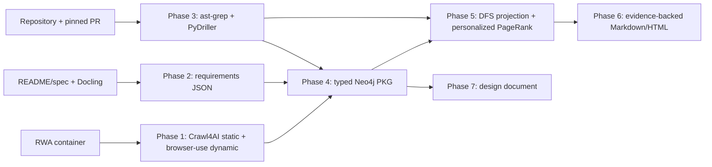
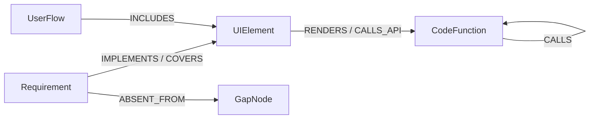

# Blast Radius Analyzer — v1 Implementation Guide

## Quick Reference

**Chosen application:** Cypress Real World App (RWA), <https://github.com/cypress-io/cypress-realworld-app>. It is the top recommendation in `d12`: a TypeScript/React/Node banking application with authentication, transfers, contacts, a rich DOM, a mature public repository, extensive product-facing README/test documentation, and active PR history. It is unusually useful because its existing end-to-end tests provide an independent oracle for evaluation.

**Important correction:** `https://example.cypress.io/real-world-app` is not an RWA deployment. The official Cypress documentation describes RWA as an application to clone and run. Therefore the MVP must crawl an RWA container started from the public repository at `http://localhost:3000`; it is publicly reproducible, but not a public hosted URL. If the reviewer interprets “public web application” as requiring a public URL, switch only `TARGET_*` to React Admin (`https://marmelab.com/react-admin-demo`, `https://github.com/marmelab/react-admin`) before Phase 1. Do not claim the Cypress example URL is RWA.

**Chosen PR:** <https://github.com/cypress-io/cypress-realworld-app/pull/1436> (“fix: update cypress logo on login page”). This is deliberately a small, historical, UI-adjacent change: it gives the 16-hour MVP a falsifiable UI-to-code path. Before implementation, fetch and pin the merge SHA with `gh pr view 1436 --repo cypress-io/cypress-realworld-app --json mergeCommit`; never analyse a moving branch tip.

**Chosen PRD source:** <https://github.com/cypress-io/cypress-realworld-app/blob/develop/README.md>, supplemented only by the repository’s public Cypress specs as executable feature documentation. The README is Markdown, so its provenance is source line range rather than a PDF page/bounding box; preserve `page: null`, `bbox: null`, and `line_start/line_end` honestly.

### Stack summary

| Component | Library/service | Pin / image | License |
|---|---|---:|---|
| Static crawl | crawl4ai | `crawl4ai==0.7.7` | Apache-2.0 |
| Dynamic crawl | browser-use + Playwright | `browser-use==0.12.1`; `playwright==1.54.0` | MIT / Apache-2.0 |
| PRD parsing | Docling | `docling==2.65.0` | MIT |
| Git/PR analysis | PyDriller | `pydriller==2.9` | Apache-2.0 |
| AST extraction | ast-grep CLI | `ast-grep==0.39.6` **VERIFY release** | MIT |
| Product graph | Neo4j | `neo4j:5.26-community` | GPLv3/community distribution |
| Retrieval augmentation | LightRAG | `lightrag-hku==1.4.9.9` **VERIFY release/API** | MIT |
| Entity resolution | Splink + DuckDB | `splink==4.0.11`; `duckdb==1.1.3` | MIT |
| PPR | NetworkX | `networkx==3.4.2` | BSD-3-Clause |
| Graph client/models | neo4j, Pydantic | `neo4j==5.28.1`; `pydantic==2.10.6` | Apache-2.0 / MIT |

Run `pip index versions <package>` inside the controlled build container immediately before committing `requirements.txt`; replace a nonexistent pin rather than silently installing an unpinned dependency. The exact LightRAG and browser-use APIs evolve quickly, so marked calls are intentionally guarded with `# VERIFY: check current API in repo docs` rather than invented.

## Architecture Overview

### Review and improvements before build

The research direction is strong, but four changes make it deliverable in 16 hours.

1. **Neo4j is the source-of-truth graph.** The assignment explicitly asks for a Neo4j knowledge graph. LightRAG is not a substitute for an inspectable, typed product graph, and “LightRAG + PostgreSQL + Apache AGE” is not an API contract confirmed by its current documentation. Run Neo4j for the scored graph. Run PostgreSQL/pgvector only for optional LightRAG retrieval metadata; Apache AGE is deferred until its extension/image compatibility is proven. This avoids building two graph writers.
2. **Do not promise browser-use AXTree export.** Use browser-use for two named stateful flows and collect its session evidence; use Playwright’s `page.locator('[role],a,button,input,select,textarea')` plus computed role/name as the stable, serialised AXTree-like artifact. This is WebArena-inspired and reproducible. Browser-use remains the dynamic explorer, not the data schema owner.
3. **Separate deterministic evidence from semantic hypotheses.** AST facts, Git diff facts, DOM roles, and PPR are deterministic. Requirement extraction and cross-layer mappings are candidates with confidence/evidence. No LLM is allowed to create an edge without a stored source excerpt and a reviewer-visible confidence.
4. **Use a projection for PPR, not an untrained GNN.** GNNExplainer requires a trained GNN prediction to explain. For v1, extract the minimal high-score shortest evidence paths from PPR/DFS; label this “GNNExplainer-inspired subgraph evidence,” not GNNExplainer. A trained GNN/ExplainVulD is next-week work.





Each relationship has `confidence`, `evidence`, `source`, `created_at`, and `run_id`. The canonical implementation trace is `Requirement -[:IMPLEMENTS]-> CodeFunction`; the impact projection uses `CodeFunction -[:RENDERS]-> UIElement -[:COVERS]-> Requirement`, which makes code-to-product propagation natural. These are complementary trace edges, not duplicate claims: both must retain separate evidence.

## Delivery rules applied to every phase

`main` is always runnable end-to-end. Start every phase from an up-to-date `main`, use its exact branch name below, run the phase’s smoke test on that branch, record the artifact, then merge. Never merge a branch merely because code exists. Every command exits non-zero on missing upstream artifacts; all writes are deterministic (content IDs plus Cypher `MERGE`) and may be re-run safely.

## Phase 0: Project Skeleton

**Goal:** create a Docker-first, importable, reproducible foundation.

**Branch name:** `setup/project-skeleton`  
**Prerequisites:** none. **Budget:** 1.25 h. **Priority:** core.

**Create:** `.env.example`, `requirements.txt`, `docker-compose.yml`, `src/blast_radius/{__init__.py,config.py,models.py}`, `tests/test_imports.py`, `README.md`.

```yaml
# docker-compose.yml
services:
  neo4j:
    image: neo4j:5.26-community
    environment:
      NEO4J_AUTH: neo4j/${NEO4J_PASSWORD:?set in .env}
      NEO4J_PLUGINS: '["apoc"]'
    ports: ["7474:7474", "7687:7687"]
    volumes: [neo4j_data:/data]
  postgres:
    image: pgvector/pgvector:pg16
    environment:
      POSTGRES_DB: lightrag
      POSTGRES_USER: lightrag
      POSTGRES_PASSWORD: ${POSTGRES_PASSWORD:?set in .env}
    ports: ["5432:5432"]
    volumes: [postgres_data:/var/lib/postgresql/data]
volumes: {neo4j_data: {}, postgres_data: {}}
```

```python
# src/blast_radius/config.py
from dataclasses import dataclass
from pathlib import Path
import os
from dotenv import load_dotenv

load_dotenv()
@dataclass(frozen=True)
class Settings:
    target_url: str = os.environ.get("TARGET_URL", "http://localhost:3000")
    repo_url: str = os.environ.get("TARGET_REPO_URL", "https://github.com/cypress-io/cypress-realworld-app.git")
    pr_number: int = int(os.environ.get("PR_NUMBER", "1436"))
    neo4j_uri: str = os.environ.get("NEO4J_URI", "bolt://localhost:7687")
    neo4j_user: str = os.environ.get("NEO4J_USER", "neo4j")
    neo4j_password: str = os.environ["NEO4J_PASSWORD"]
    data_dir: Path = Path(os.environ.get("DATA_DIR", "data"))
settings = Settings()
```

```python
# src/blast_radius/models.py
from pydantic import BaseModel, Field
class Provenance(BaseModel):
    source_file: str; page: int | None = None; bbox: list[float] | None = None
    line_start: int | None = None; line_end: int | None = None; excerpt: str
class Transition(BaseModel): action: str; target_url: str; selector: str | None = None
class PageSnapshot(BaseModel):
    url: str; dom_snapshot: str; accessibility_tree: list[dict]; screenshot_path: str
    transitions: list[Transition] = Field(default_factory=list)
class Requirement(BaseModel): requirement_id: str; text: str; provenance: Provenance
```

Use `.env.example` with `NEO4J_PASSWORD=change-me`, `POSTGRES_PASSWORD=change-me`, `TARGET_URL=http://localhost:3000`, `TARGET_REPO_URL=...`, `PR_NUMBER=1436`; never commit `.env`.

**Smoke test:** `docker compose --env-file .env up -d && python -c "from blast_radius.config import settings; from blast_radius.models import PageSnapshot; print(settings.target_url)" && pytest -q tests/test_imports.py`.

**Merge condition:** Compose shows both services healthy/running and all package imports/tests pass. **If skipped:** every later phase has ambiguous paths, credentials, and graph endpoint.

**Common failures:** missing `.env` causes a deliberate `KeyError`—copy the example; Neo4j port collision—change the host port in `.env` and URI together; browser packages fail on host—install Python dependencies in a project virtualenv/container, not globally.

**Not yet:** no RWA source install, no crawling, no external secret, no AGE extension.

## Phase 1: Crawler MVP

**Goal:** capture at least ten reproducible, schema-valid UI state snapshots and transitions from RWA.

**Branch name:** `feature/phase-1-crawler`  
**Prerequisites:** `setup/project-skeleton` merged. **Budget:** 2.25 h. **Priority:** core.

**Create:** `src/blast_radius/crawl/{__init__.py,static.py,dynamic.py,artifacts.py}`, `scripts/crawl.py`, `tests/test_crawl_schema.py`, `data/crawl/.gitkeep`.

Start the public RWA repository at its pinned SHA according to its README before crawling. This is real application data, not a mock. `crawl4ai` supplies the static discovery pass; browser-use performs exactly two flows (sign-in and transaction/contact navigation) using non-production demo credentials only. Do not automate banking actions.

```python
# src/blast_radius/crawl/static.py
import asyncio
from crawl4ai import AsyncWebCrawler, BrowserConfig, CacheMode

async def crawl_static(urls: list[str]) -> dict[str, str]:
    config = BrowserConfig(headless=True)
    async with AsyncWebCrawler(config=config) as crawler:
        results = await crawler.arun_many(urls, cache_mode=CacheMode.BYPASS)
    failed = [r.url for r in results if not r.success]
    if failed: raise RuntimeError(f"static crawl failed: {failed}")
    return {r.url: r.html for r in results}

if __name__ == "__main__": asyncio.run(crawl_static(["http://localhost:3000"]))
```

```python
# src/blast_radius/crawl/dynamic.py
import asyncio
from browser_use import Agent, BrowserSession
# VERIFY: check current browser-use README: LLM provider constructor and Agent.run API.

async def discover_spa_flow(task: str, llm) -> object:
    session = BrowserSession()
    agent = Agent(task=task, llm=llm, browser_session=session)
    result = await agent.run()
    if result is None: raise RuntimeError("browser-use produced no flow result")
    return result

async def capture_page(page, output_path: str) -> dict:
    await page.screenshot(path=output_path, full_page=True)
    dom = await page.content()
    items = await page.locator("a,button,input,select,textarea,[role]").evaluate_all("""
      els => els.slice(0,250).map((e,i) => ({index:i, tag:e.tagName, role:e.getAttribute('role'),
      name:e.getAttribute('aria-label') || e.innerText || e.getAttribute('name') || '',
      selector:e.id ? '#'+e.id : e.getAttribute('data-test') ? '[data-test="'+e.getAttribute('data-test')+'"]' : e.tagName.toLowerCase()}))
    """)
    return {"dom_snapshot": dom, "accessibility_tree": items}
```

`artifacts.py` writes one `PageSnapshot.model_dump(mode="json")` per SHA-256 URL to `data/crawl/`, an image under `data/crawl/screenshots/`, and `manifest.json`. The dynamic flow collector must record action, source selector, destination URL, and before/after screenshot IDs. Never write artifacts only in browser history.

**Schema:** the Phase 0 `PageSnapshot` exactly matches `{url, dom_snapshot, accessibility_tree, screenshot_path, transitions[]}`. Reject empty `dom_snapshot`, absent images, or a transition target outside `TARGET_URL`.

**Smoke test:** `python scripts/crawl.py --url http://localhost:3000 --max-pages 10 && python -c "import json,glob; from blast_radius.models import PageSnapshot; fs=glob.glob('data/crawl/*.json'); assert len(fs)>=10, len(fs); [PageSnapshot.model_validate_json(open(f,encoding='utf8').read()) for f in fs]; print(len(fs))"`.

**Merge condition:** ≥10 valid snapshot files, screenshots exist, and at least two named transitions are in the manifest. **If skipped:** graph construction has no observed UI layer and PR impact becomes only file-level speculation.

**Common failures:** SPA routes collapse to one URL—key state by `(url, DOM hash)`; browser-use version/API moves—use the marked verification point and retain Playwright capture; crawler blocked/slow—crawl local RWA, lower concurrency to one, and obey its development-only scope.

**Not yet:** vision/Skyvern, Screen2Vec, authenticated financial writes, generic autonomous exploration.

## Phase 2: PRD Ingest

**Goal:** extract source-grounded requirements rather than free-form product summaries.

**Branch name:** `feature/phase-2-prd-ingest`  
**Prerequisites:** Phase 0. **Budget:** 1.25 h. **Priority:** core.

**Create:** `src/blast_radius/ingest/{__init__.py,docling_ingest.py,requirements.py}`, `scripts/ingest_prd.py`, `data/requirements/.gitkeep`, `tests/test_requirement_provenance.py`.

```python
# src/blast_radius/ingest/docling_ingest.py
from docling.document_converter import DocumentConverter
from blast_radius.models import Provenance, Requirement

def convert(source: str) -> str:
    result = DocumentConverter().convert(source)
    if result.document is None: raise RuntimeError(f"Docling conversion failed: {source}")
    return result.document.export_to_markdown()

def requirements_from_markdown(markdown: str, source_file: str) -> list[Requirement]:
    out=[]
    for line_no, line in enumerate(markdown.splitlines(), 1):
        if line.startswith(("#", "- ", "* ")) and len(line.strip("# -*")) > 12:
            text=line.strip("# -*")
            out.append(Requirement(requirement_id=f"REQ-{len(out)+1:03d}", text=text,
                provenance=Provenance(source_file=source_file, line_start=line_no, line_end=line_no,
                                      page=None, bbox=None, excerpt=line)))
    if len(out) < 5: raise RuntimeError("fewer than five candidate requirements; inspect source/heuristic")
    return out
```

For PDF/DOCX input, iterate Docling text items and copy their `prov` values to `page`/`bbox`; **VERIFY: check current DoclingDocument item traversal API**. For Markdown, retain line provenance as above. An optional LLM may split a paragraph into requirements, but must return quoted spans; reject results that cannot be aligned to a source span.

**Schema:** `Requirement` from Phase 0; serialise `data/requirements/requirements.json` as a JSON array. IDs are deterministic from `sha256(source_file + normalized_text)[:12]`, not discovery order, in final code.

**Smoke test:** `python scripts/ingest_prd.py --source https://raw.githubusercontent.com/cypress-io/cypress-realworld-app/develop/README.md && python -c "import json; x=json.load(open('data/requirements/requirements.json')); assert len(x)>=5 and all(r['provenance']['source_file'] and r['provenance']['excerpt'] for r in x); print(len(x))"`.

**Merge condition:** requirements artifact exists, ≥5 distinct nodes have non-null provenance/excerpt. **If skipped:** the report cannot cite intended product behaviour or model absence honestly.

**Common failures:** README is operational rather than a PRD—include public feature specs, label their provenance; Docling cannot fetch raw GitHub URL—download it once to `data/sources/` with checksum then convert; LLM paraphrases evidence—only report original excerpt.

**Not yet:** a trained UserTrace/SimCSE pipeline, requirements hierarchy beyond minimal `Feature`, or OCR/VLM enrichment.

## Phase 3: Code Analysis

**Goal:** produce a real, queryable TypeScript function/call graph and PR delta.

**Branch name:** `feature/phase-3-code-analysis`  
**Prerequisites:** Phase 0. **Budget:** 2.25 h. **Priority:** core.

**Create:** `rules/typescript-functions.yml`, `src/blast_radius/code/{__init__.py,index.py,pr.py}`, `scripts/index_repo.py`, `scripts/inspect_pr.py`, `data/code/.gitkeep`, `tests/test_code_graph.py`.

```yaml
# rules/typescript-functions.yml
id: ts-function
language: typescript
rule:
  any:
    - kind: function_declaration
    - kind: method_definition
    - kind: arrow_function
```

```python
# src/blast_radius/code/pr.py
from pydriller import Repository
def commits_for_range(repo_path: str, from_commit: str, to_commit: str) -> list[dict]:
    commits=[]
    for commit in Repository(repo_path, from_commit=from_commit, to_commit=to_commit).traverse_commits():
        commits.append({"hash": commit.hash, "files": [m.new_path or m.old_path for m in commit.modified_files]})
    if not commits: raise RuntimeError("PyDriller found no commits; verify merge-parent range")
    return commits
```

```python
# src/blast_radius/code/index.py
import json, subprocess
from pathlib import Path
def ast_matches(repo: Path) -> list[dict]:
    p=subprocess.run(["sg", "scan", "--rule", "rules/typescript-functions.yml", str(repo), "--json=stream"],
                     text=True, capture_output=True, check=True)
    rows=[json.loads(line) for line in p.stdout.splitlines() if line.strip()]
    if not rows: raise RuntimeError("ast-grep returned no TypeScript functions")
    return rows
# Call edges are conservative: resolve only same-file unique callees; mark all others unresolved.
```

Use ast-grep CLI rather than its MCP server in production code: it is versioned, deterministic, and testable. The MCP server is a developer investigation tool only. Build `function_id = repo_relative_path + ':' + start_line + ':' + name`; parse ast-grep JSON location fields **after verifying the installed `sg --help` output**. Extract `calls[]` from AST call expressions; do not fabricate import-aware resolution. The requested output is:

```json
{"function_id":"src/x.ts:14:save","file":"src/x.ts","calls":["src/x.ts:9:validate"],"called_by":[],"ast_node_type":"function_declaration"}
```

**Smoke test:** `python scripts/index_repo.py --repo data/repos/cypress-realworld-app && python scripts/inspect_pr.py --repo data/repos/cypress-realworld-app --pr 1436 && python -c "import json; x=json.load(open('data/code/call_graph.json')); assert len(x)>=50; n=next(v for v in x if v['calls'] or v['called_by']); print(n['function_id'],n['calls'],n['called_by'])"`.

**Merge condition:** `call_graph.json` has ≥50 unique nodes and a known function query returns caller/callee evidence; `pr_1436.json` names actual changed files from the pinned merge range. **If skipped:** PPR has no legitimate seed or internal propagation edges.

**Common failures:** shell `sg` missing—install the pinned binary in the dev container, never regex-replace it; Vue/TSX parsing mismatch—add language-specific rules and report coverage; squash PR has no range—calculate parent of merge SHA to merge SHA and store both.

**Not yet:** Joern CPG/CFG/PDG, cross-module type resolution, runtime Ekstazi. Joern is the next-week upgrade; its JVM/Scala cost is unjustified here.

## Phase 4: Knowledge Graph Construction

**Goal:** fuse evidence into an idempotent, inspectable three-layer product knowledge graph and represent absence explicitly.

**Branch name:** `feature/phase-4-knowledge-graph`  
**Prerequisites:** Phases 1–3 merged. **Budget:** 2.5 h. **Priority:** polish/core only if time permits.

**Create:** `src/blast_radius/graph/{__init__.py,neo4j.py,schema.py,load.py,resolve.py}`, `src/blast_radius/retrieval/lightrag.py`, `scripts/build_graph.py`, `tests/test_graph.py`.

```python
# src/blast_radius/graph/schema.py
SCHEMA = [
 "CREATE CONSTRAINT requirement_id IF NOT EXISTS FOR (n:Requirement) REQUIRE n.id IS UNIQUE",
 "CREATE CONSTRAINT ui_id IF NOT EXISTS FOR (n:UIElement) REQUIRE n.id IS UNIQUE",
 "CREATE CONSTRAINT function_id IF NOT EXISTS FOR (n:CodeFunction) REQUIRE n.id IS UNIQUE",
 "CREATE CONSTRAINT gap_id IF NOT EXISTS FOR (n:GapNode) REQUIRE n.id IS UNIQUE",
]
UPSERT = """MERGE (a {id:$from_id}) MERGE (b {id:$to_id})
MERGE (a)-[r:%s]->(b) SET r.confidence=$confidence,r.evidence=$evidence,r.source=$source,r.run_id=$run_id"""
```

```python
# src/blast_radius/graph/neo4j.py
from neo4j import GraphDatabase
from blast_radius.config import settings
def driver(): return GraphDatabase.driver(settings.neo4j_uri, auth=(settings.neo4j_user, settings.neo4j_password))
def ensure_schema(d):
    with d.session() as s:
        for q in __import__('blast_radius.graph.schema', fromlist=['SCHEMA']).SCHEMA: s.run(q).consume()
```

```python
# src/blast_radius/graph/resolve.py
import pandas as pd
from splink import DuckDBAPI, Linker, SettingsCreator, block_on
import splink.comparison_library as cl
def candidate_links(requirements, entities):
    left=pd.DataFrame([{"id":r["requirement_id"],"label":r["text"],"dataset":"req"} for r in requirements])
    right=pd.DataFrame([{"id":e["function_id"],"label":e["function_id"],"dataset":"code"} for e in entities])
    settings=SettingsCreator(link_type="link_only", unique_id_column_name="id", source_dataset_column_name="dataset",
      comparisons=[cl.JaroAtThresholds("label", [0.85,0.95])], blocking_rules_to_generate_predictions=[block_on("label")])
    linker=Linker([left,right], settings, db_api=DuckDBAPI())
    return linker.inference.deterministic_link().as_pandas_dataframe()
```

The Splink example is a **candidate generator**, not proof: exact blocking on whole labels will have low recall. Add normalized token blocking, semantic cross-encoder review only for candidate pairs, and require manual confirmation below 0.85. Do not train Splink/EM in v1 without labelled pairs.

LightRAG is optional retrieval augmentation, not graph persistence:

```python
# src/blast_radius/retrieval/lightrag.py
# VERIFY: check installed LightRAG README for current init/storage classes.
from lightrag import LightRAG
def make_retriever():
    return LightRAG(working_dir="data/lightrag")
```

Only enable its PostgreSQL backend after a tested current configuration. Apache AGE is omitted from runtime because its installation/version contract with pgvector/LightRAG is unverified; document it as a future shared-store experiment.

**Schema:** node labels `Requirement`, `UIElement`, `CodeFunction`, `APIEndpoint`, `UserFlow`, `Page`, `GapNode`; edges `IMPLEMENTS` (Requirement→CodeFunction), `RENDERS` (CodeFunction→UIElement), `CALLS`, `COVERS` (UIElement→Requirement), `ABSENT_FROM`, plus `INCLUDES`, `NAVIGATES_TO`. `ABSENT_FROM` is not inferred from silence alone: if a requirement has no outgoing `IMPLEMENTS` and no incoming `COVERS` at `confidence >= 0.60`, create `(:Requirement)-[:ABSENT_FROM {reason,threshold,run_id}]->(:GapNode {id:'gap:'+requirement_id})`. It answers “intended but untestable” with an auditable fact.

**Smoke test:** `python scripts/build_graph.py && python -c "from blast_radius.graph.neo4j import driver; d=driver(); r=d.execute_query('MATCH (r:Requirement)-[:IMPLEMENTS]->(c:CodeFunction) RETURN r,c LIMIT 5').records; assert r, 'no cross-layer links'; print(len(r)); d.close()"`.

**Merge condition:** all three layers have populated node labels, ≥1 cross-layer edge, and `ABSENT_FROM` query is non-empty or explicitly returns zero with logged evidence. **If skipped:** Phase 5 may use the saved JSON projection, but not the assignment-required queryable graph.

**Common failures:** graph double-counts reruns—use stable IDs and `MERGE`; entity matches look plausible but are wrong—store candidate score and downgrade/omit; no cross-layer edge—review RWA component/file naming and add a manual seed mapping with evidence, never lower the threshold silently.

**Not yet:** Microsoft GraphRAG/Leiden (too slow for incremental PR work), full LightRAG/AGE integration, vector-only relationships.

## Phase 5: Blast Radius Reasoning

**Goal:** compute deterministic, evidence-backed impact from PR #1436 to UI and requirements.

**Branch name:** `feature/phase-5-blast-radius`  
**Prerequisites:** Phases 0–4 merged; if Phase 4 is deferred, load the same typed JSON graph projection and label report mode `projection-only`. **Budget:** 2.25 h. **Priority:** core.

**Create:** `src/blast_radius/reason/{__init__.py,ppr.py,impact.py,evidence.py}`, `scripts/analyze_pr.py`, `data/reports/.gitkeep`, `tests/test_ppr.py`.

```python
# src/blast_radius/reason/ppr.py
import networkx as nx
def score(graph: nx.DiGraph, seeds: list[str]) -> dict[str,float]:
    if not seeds: raise RuntimeError("no PR seeds map to indexed code nodes")
    for seed in seeds:
        if seed not in graph: raise RuntimeError(f"missing seed: {seed}")
    personalization={n: 0.0 for n in graph}; weight=1.0/len(seeds)
    for s in seeds: personalization[s]=weight
    return nx.pagerank(graph.reverse(copy=False), alpha=0.85, personalization=personalization,
                       max_iter=100, tol=1e-8, weight="weight")
```

Use only a typed projection: `CALLS=1.0`, `RENDERS=0.95`, `IMPLEMENTS=0.85`, `COVERS=0.75`; preserve direction code→UI→requirement. PPR is a relative ranking, not calibrated probability. Convert it to `impact_score` by min-max normalising **within this PR only**, and separately report `traceability_confidence` (minimum edge confidence on evidence path). A finding is high only when both are ≥0.70; medium when ≥0.40; otherwise manual review. DFS is static over this projection, capped at six hops, not Ekstazi’s runtime test selection.

```python
# src/blast_radius/reason/evidence.py
import networkx as nx
def evidence_path(g: nx.DiGraph, seed: str, target: str) -> list[str]:
    path=nx.shortest_path(g, seed, target, weight=lambda u,v,d: 1/d.get("weight",1.0))
    if len(path)>7: raise RuntimeError("evidence path exceeded six-hop cap")
    return path
```

**Schema:**

```json
{"pr_url":"https://github.com/cypress-io/cypress-realworld-app/pull/1436","changed_files":["..."],"affected_ui_elements":[{"id":"ui:...","impact_score":0.81,"traceability_confidence":0.9,"evidence_path":["fn:...","ui:..."]}],"affected_requirements":[{"id":"REQ-...","impact_score":0.72,"provenance":{"source_file":"...","line_start":12}}],"confidence_scores":{"ui:...":0.81},"evidence_subgraph":[{"from":"...","type":"RENDERS","to":"..."}],"manual_review_items":[]}
```

**Smoke test:** `python scripts/analyze_pr.py --pr 1436 && python -c "import json; x=json.load(open('data/reports/blast_radius_report.json')); assert x['affected_ui_elements'] and x['affected_requirements'] and x['evidence_subgraph']; assert all(0<=v<=1 for v in x['confidence_scores'].values()); print(x['pr_url'])"`.

**Merge condition:** validated non-empty report names at least one UIElement and Requirement, scores are 0–1, and evidence subgraph contains paths from an actual changed function. **If skipped:** Phase 6 is presentation without the required impact analysis.

**Common failures:** changed line is not in a function—seed CodeFile and mark coarse confidence; dense utility fan-out—cap hops and raise “broad impact”; no path—create a `DARK_CHANGE` manual-review finding, never an empty success.

**Not yet:** OpenHands execution, learned PPR weights, GNNExplainer/ExplainVulD training. GNNExplainer pattern is fulfilled by minimal path extraction, with this limitation explicit.

## Phase 6: Human-Readable Report

**Goal:** turn structured evidence into a report a QA lead can act on without reading code.

**Branch name:** `feature/phase-6-report`  
**Prerequisites:** Phase 5 merged. **Budget:** 1.0 h. **Priority:** polish.

**Create:** `src/blast_radius/report/{__init__.py,render.py}`, `scripts/render_report.py`, `tests/test_report.py`.

```python
# src/blast_radius/report/render.py
from pathlib import Path
from jinja2 import Environment, FileSystemLoader
def render(report: dict) -> Path:
    if not report["evidence_subgraph"]: raise RuntimeError("refusing report without evidence")
    template=Environment(loader=FileSystemLoader("templates"), autoescape=True).get_template("report.html.j2")
    out=Path("data/reports/blast_radius_report.html")
    out.write_text(template.render(report=report), encoding="utf-8")
    return out
```

Add `jinja2==3.1.5` to the locked requirements before this code. The HTML must include a plain-English summary generated only from structured fields, affected-flow table, risk by requirement, score/threshold legend, exact evidence chain, and PRD README line hyperlinks. It must state “manual review” for low-confidence or dark changes; no confident prose may outrun an edge.

**Schema:** report input is Phase 5 JSON; outputs `data/reports/blast_radius_report.md` and `.html`. All requirement rows carry `provenance.source_file` plus `line_start`; `page`/`bbox` display only when non-null.

**Smoke test:** `python scripts/render_report.py && python -c "from pathlib import Path; p=Path('data/reports/blast_radius_report.html'); s=p.read_text(); assert all(x in s for x in ['Executive Summary','Affected Flows','Why this is at risk','Manual review']); print(p)"`.

**Merge condition:** report opens locally, sections render, each requirement has a working source reference, and an uninvolved reviewer can identify what to test. **If skipped:** impact remains inaccessible to the assignment’s non-engineer audience.

**Common failures:** source links break due to a moving branch—link pinned commit SHA; HTML injection—Jinja autoescape; LLM-like claims lack evidence—template only renders structured evidence and fails on blank paths.

**Not yet:** PR comment/webhook, Lobe UI, PDF generation.

## Phase 7: Design Document Scaffold

**Goal:** write the defensible engineering narrative for all assignment criteria.

**Branch name:** `feature/phase-7-design-doc`  
**Prerequisites:** Phases 0–6 merged (or explicitly documented deferred artifacts). **Budget:** 1.25 h. **Priority:** polish.

**Create:** `docs/design_document.md`, `docs/evaluation_protocol.md`, `docs/decision_log.md`, `tests/test_design_doc.py`.

Populate the design document with ten numbered answers: (1) crawl artifact/evidence, (2) PRD ingestion/provenance, (3) three-layer graph, (4) PR reasoning, (5) deterministic/LLM agent decomposition, (6) schema and absence query, (7) confidence/escalation, (8) one-PR evaluation and stability, (9) cuts/depth, (10) next week. Cite generated artifact paths and exact commands, not aspirations.

**Smoke test:** `python -c "p=open('docs/design_document.md',encoding='utf8').read(); assert all(f'{i}.' in p for i in range(1,11)); assert len(p)>12000; print('design doc complete')"`.

**Merge condition:** every criterion has substantive evidence-backed prose, a clear cut rationale, and no placeholder. **If skipped:** the code cannot earn half the assignment score allocated to judgment/design.

**Common failures:** claiming LightRAG/AGE as implemented when it is optional—state actual state; hiding weak mappings—report thresholds and false-positive risk; eval asserts test coverage equals truth—use manual gold labels and record disagreements.

**Not yet:** Loom recording (after a clean main checkout), full SWE-bench.

## Scope Decisions & Honest Tradeoffs

- **Adopt:** Crawl4AI/AXTree-inspired DOM artifacts, browser-use dynamic flows, Docling conversion/provenance, PyDriller PR facts, ast-grep structural facts, Splink candidate linkage, HippoRAG-style PPR, and evidence-subgraph explanations.
- **Adapt:** DeepMatcher becomes cross-encoder/manual review only after Splink candidate blocking; Ekstazi becomes static DFS on the product graph; Screen2Vec becomes DOM-role/name features; UserTrace becomes provenance-constrained requirement-to-code candidate generation.
- **Ignore:** ReqToCode workflow changes and full SWE-bench evaluation.
- **Joern:** theoretically better CPG, deferred because JVM/Scala setup crowds out the working slice. It is the first next-week upgrade.
- **Microsoft GraphRAG:** strong macro summaries/Leiden, deferred because full re-indexing is unsuitable for PR-time MVP. LightRAG is optional incremental retrieval augmentation, not a replacement for Neo4j.
- **Skyvern and Screen2Vec:** deferred for cost/latency; Skyvern is also AGPL and must not be a runtime dependency. Slither is reference-only for the same license reason.
- **Agent scope:** narrow-but-deep: one RWA repository, one pinned PR, two dynamic flows, ten snapshots. No generic SaaS agent claim.
- **OpenHands:** architecture only. A Docker sandboxed ambiguity investigator is valuable after the deterministic report is stable; it is not required to score the MVP and is not started with host credentials.

## Time Budget

| Phase | Estimated hours | Priority |
|---|---:|---|
| 0 — scaffold | 1.25 | Core |
| 1 — crawler | 2.25 | Core |
| 2 — PRD ingest | 1.25 | Core |
| 3 — code analysis | 2.25 | Core |
| 4 — graph | 2.50 | Core if time permits |
| 5 — reasoning | 2.25 | Core |
| 6 — report | 1.00 | Polish |
| 7 — design document | 1.25 | Polish but scored |
| **Total** | **14.0** | **2 h buffer** |

If time expires, do not start a half-built LightRAG/AGE or browser-use abstraction. Preserve a working `main` with Phases 0–3 and 5 using the JSON projection, then add Phase 4’s Neo4j evidence and Phase 6/7 narrative.

## What to Build Next Week (Top 3)

1. **Joern CPG plus verified frontend build mapping:** add CFG/PDG/dataflow and import-aware resolution so dark changes are smaller and evidence is causal, not merely lexical.
2. **PR webhook with incremental graph update:** use qodo-ai/pr-agent’s webhook/diff-compression pattern, generate report comments, and version graph artifacts by commit SHA.
3. **Labelled entity resolution and evaluation harness:** collect reviewer confirmations, train/calibrate Splink/cross-encoder thresholds, run multiple curated RWA PRs, and report precision, recall, absence recall, evidence quality, plus three-run Jaccard stability. Full SWE-bench follows only after this meaningful local gold set exists.
