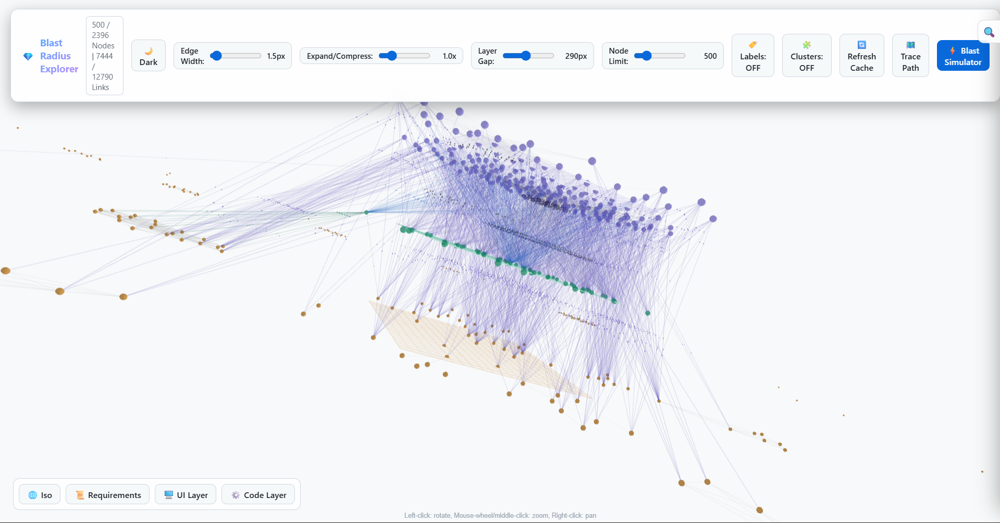

# CASCADE

*Change Analysis for Software Cascade using Dependency Evidence.* Give CASCADE a GitHub PR URL and it tells QA leads and engineers what to test: which UI pages are at risk, which product requirements lose coverage, and which changed functions have no traceable path to any product feature.

## The problem

A diff lists changed files, but QA needs the affected product behaviour. CASCADE links product requirements, the live UI and the source code into one graph, walks it from the changed functions with Personalized PageRank, and writes a report a non-engineer can act on.

## Pages

- [Architecture](architecture.html): offline graph build, online per-PR analysis, graph schema
- [Setup](setup.html): install, build the graph, analyze a PR
- [Design document (21 pages, Markdown)](https://github.com/The-Harsh-Vardhan/CASCADE/blob/main/submission/design%20document/design_document_expanded.md)
- [Sample blast radius report for Documenso PR #3046](https://github.com/The-Harsh-Vardhan/CASCADE/blob/main/submission/blast%20radius%20report/pr_3046_blast_radius.md)
- [Interactive 3D graph explorer](https://cascade-graph-explorer.vercel.app)
- [Loom walkthrough (9:53)](https://www.loom.com/share/cdab254822bd4cbfbc5ebf0c9c79874e)
- [Source on GitHub](https://github.com/The-Harsh-Vardhan/CASCADE)

## Result on a real PR

Documenso PR #3046 (29 files changed): 1 affected UI page, 6 priority QA scenarios, 12 dark changes and 6 absent requirements, from the committed report.

