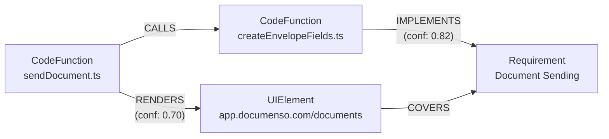

# Blast Radius Analyzer — Submission Guide

> A complete, ordered checklist from current state to final submission.
> Built from audit findings, assignment requirements, and the actual pipeline output.

---

## Where You Stand Right Now

You have a working pipeline (v4), a blast radius report for PR #3046, a README, and a v1 design document. The pipeline actually runs. The report is real output from real code. That puts you ahead of most submissions.

What you don't have yet:

- A design document that passes the senior engineer test (seven specific gaps identified in the audit)
- A Loom video
- A GitHub repo that's submission-ready (secrets, README clarity, end-to-end runability)

The guide below is ordered by dependency — fix the things other things depend on first.

---

## Phase A: Code & Repository (Do This First)

These tasks are prerequisites for everything else. The Loom can't be recorded until the pipeline runs cleanly. The design document can't reference eval results that haven't been run.

### A1 — Clean Up the GitHub Repo

**Goal:** Someone following the README should be able to clone and run without Slack-messaging you.

- [ ] Remove all hardcoded API keys, credentials, and email addresses from committed files. Search the entire repo: `git log -S "anthropic" --all` and `grep -r "ANTHROPIC" . --include="*.py"`.
- [ ] Verify `.env.example` exists and has every required key listed with placeholder values and a comment explaining where to get each one.
- [ ] Confirm `.env` itself is in `.gitignore` and not committed. Run `git status` and `git log --all --full-history -- .env` to be sure.
- [ ] **Remove or reframe the "10-key rotation pool" from all config tables and documentation.** The audit flags this as a credibility risk — rotating free-tier keys to exceed quota is a terms-of-service issue some evaluators will flag. If you need to mention multiple keys, say "multiple project API keys" without the quota-avoidance framing.
- [ ] Rename `data/` entries to confirm everything gitignored correctly — crawl snapshots, graph data, and reports should not be in the repo. Only the final sample `blast_radius_report.md` should be committed (as the required deliverable).

### A2 — Verify the Pipeline Runs End-to-End on a Clean Clone

**Goal:** The evaluators will try to run this. It needs to work.

```bash
# Simulate a fresh evaluator environment:
git clone https://github.com/The-Harsh-Vardhan/blast-radius-analyzer /tmp/test-clone
cd /tmp/test-clone
uv pip install -e ".[dev]"
playwright install chromium
cp .env.example .env
# Fill in .env with real values
python scripts/validate_env.py
python scripts/run_pipeline.py --all
```

- [ ] Run through this yourself, start to finish. Fix every error that isn't explained in the Troubleshooting table.
- [ ] If Phase 1 (crawl) is brittle due to `app.documenso.com` UI changes, add a `--use-fixture` flag that reads from saved `data/crawl/` snapshots instead of live-crawling. Document this in the README as the fallback for evaluators who don't want to create a Documenso account.
- [ ] Confirm Phase 3 works on the cloned `data/repos/documenso` directory. If the path is hardcoded, parameterize it via `.env`.
- [ ] Add a `# Run all phases sequentially` section to the README showing expected output per phase — specifically what "PASS" looks like for each smoke test.

### A3 — Fix the Two Concrete Code Bugs the Design Document References

The audit and design doc both name specific bugs that were fixed. Confirm these fixes are actually in the repo:

- [ ] **P0-21 (IMPLEMENTS edge direction):** Open `blast_radius/graph/resolve.py` (or equivalent). Confirm `from_id` is `CodeFunction.id` and `to_id` is `Requirement.id` — not the reverse.
- [ ] **Phase 5 seed path alignment:** Open `blast_radius/reason/ppr.py`. Confirm the path comparison between `call_graph.json` file paths and `pr_{n}.json` changed files uses consistent path formats (both repo-relative, both with or without leading `/`).

### A4 — Add the `--use-fixture` Mode to Phase 1 (Strongly Recommended)

The crawl is the most fragile phase because it depends on a live website with credentials. If an evaluator can't create a Documenso account or the website changes, the whole pipeline dies at Phase 1.

- [ ] Add a `CRAWL_USE_FIXTURE=true` env variable that skips live crawling and reads from committed fixture snapshots in `data/crawl/fixtures/`.
- [ ] Commit 3–5 representative `PageSnapshot` fixtures (settings page, document list, signing page) so Phase 1 produces real-looking output even in fixture mode.
- [ ] Document this mode prominently in the README under a **"Running Without a Documenso Account"** section.

---

## Phase B: Design Document Fixes

The audit identified seven specific issues. They are ordered here by severity (the ones that cost the most points are first).

### B1 — Add UserFlow to the Schema (Critical — The Evaluators Will Flag This)

The assignment explicitly asks: **"which discovered user flows are affected."** The current graph has no `UserFlow` node. The document never explains this omission. This is the single biggest structural gap.

**Option 1 (implement it, ~2 hours):** Add a `UserFlow` node type. Populate it from Phase 1 by treating each Playwright navigation sequence as a flow. Schema:

```
UserFlow(id, label, steps, entry_url, exit_url)
```

Edge types to add:
```
TRAVERSES: UserFlow → UIElement   (the pages the flow visits)
SATISFIES: UserFlow → Requirement (if the flow exercises a requirement's keywords)
```

Then update the Cypher query to include `UserFlow` paths.

**Option 2 (scope it out explicitly, ~20 minutes):** Add the following to Section 5 of the design document:

> "UserFlow modeling was explicitly scoped out. Extracting user flows requires stateful Playwright interaction scripts beyond the current crawl's breadth-first navigation — each flow requires a domain-specific sequence (login → upload document → add recipient → send). At 16 hours, instrumenting even 3–4 key flows would have consumed the entire crawl time budget. The crawl instead produces `UIElement` nodes (pages) which serve as a proxy for flow nodes. Next steps: instrument 4 canonical flows (signing, template creation, team invite, API key generation) as Playwright scripts, emit `UserFlow` nodes with `TRAVERSES` edges, and add flow impact to the PPR seed set."

Option 2 is faster. Option 1 makes the submission stronger. If you have time, do Option 1. If not, do Option 2 — but you must do one of them.

### B2 — Answer the 100-Runs Question Concretely (Section 4)

This is the weakest section according to the audit. The evaluators' exact question: "If we ran your system 100 times on the same input, how would we know which runs were correct?"

Do the following and add the results to Section 4:

**Step 1 — Run the pipeline twice on PR #3046.** Run Phase 2 and Phase 4 twice independently (different LLM calls). Compare:
- Do both runs produce the same number of `Requirement` objects?
- Do both runs produce the same set of IMPLEMENTS edges?
- Do any edges appear in Run 1 but not Run 2?

Report the results honestly even if some edges flip. Two runs is not 100, but it's evidence you actually tested stability.

**Step 2 — Bound recall for one requirement.** Pick "document sending" (or "attachment management" — whichever is most relevant to PR #3046). Manually trace 3–5 functions in the Documenso codebase that implement it. Check whether those function IDs appear in `entity_links.json`. Report: "3 of 5 manually identified functions appear in IMPLEMENTS edges; 2 were missed by `ast-grep` because they are defined via tRPC procedure chaining." This is partial recall evidence, and honest partial evidence is better than no evidence.

**Step 3 — Report the confidence score distribution.** The document says "23 LLM-confirmed, 0 cosine-only." Add: what is the distribution of confidence scores across the 23? If all 23 are above 0.85, stability is high and you can say so. If 8 are between 0.65 and 0.70, those 8 are the unstable ones.

Add this to Section 4 as a subsection: **"Empirical Stability Check (Two Runs)"**

### B3 — Fix the UIElement Schema Contradiction

The node schema block defines:
```
UIElement(id, label, url, selector, page_title)
```

But the text says `url_sha256` is the stable identifier. These contradict each other.

- [ ] Change the schema block to: `UIElement(id, label, url, url_sha256, selector, page_title)`
- [ ] Add one sentence: "`url_sha256` is the graph node key — not `url` — to maintain stability across query-parameter changes."

This is a 5-minute fix. Do it.

### B4 — Specify N in "top-N candidates" for Phase 4

The document says "top-N candidates" in the Phase 4 hybrid description but never says what N is. The Appendix configuration table doesn't list it.

- [ ] Add to the Appendix configuration table: `LLM rerank top-N | 15 | Caps LLM calls per run at 15 × batch_size = 150 pairs max`
- [ ] In the Phase 4 description, change "reranks the top-N candidates" to "reranks the top-15 candidate pairs (cosine score ≥ 0.25, ranked by score descending)."

### B5 — Add a Graph Diagram to Section 2

Section 2 describes a 4-node, 4-edge schema. There is no visual. Add a Mermaid diagram showing one concrete traversal path:



This makes the schema tangible in a way that prose cannot. Add it immediately after the Edge Types section.

### B6 — Fix the "Chain of Prompts" Subheading

The audit flags the "Why this is not a chain of prompts" subheading as drawing attention to the objection. Rename it to something that describes the architecture rather than defending it:

- Change from: `**Why this is not "a chain of prompts."**`
- Change to: `**LLM invocation is bounded to two phases.**`

The content under it is fine. Just remove the defensive framing.

### B7 — Consolidate tRPC References

The tRPC abstraction gap is mentioned in Sections 1, 3, 5, and 6. By Section 5 a reader feels you are over-explaining.

- [ ] In Section 1: keep one sentence — "The tRPC abstraction prevents static analysis from tracing client-side calls to server handlers; see Section 5."
- [ ] In Section 3: keep one sentence — "The 13 dark changes for PR #3046 are a consequence of the tRPC abstraction gap documented in Section 5."
- [ ] In Section 5: keep the full explanation (this is the right home for it).
- [ ] In Section 6: keep the full fix plan (this is correct — it belongs in "what's next").

### B8 — Expand the Document to 8–12 Pages

The current document is approximately 5–6 pages. The assignment asks for 8–12. The sections that need expansion are:

- **Section 4** will grow by adding the empirical stability check (B2 above — estimated +1.5 pages)
- **Section 2** will grow by adding the graph diagram and the UserFlow node (B1 + B5 — estimated +0.5 pages)
- **Section 3** add a worked example showing the two-score multiplication for a concrete node (see next item)

**Add a worked example to Section 3:**

> "For the `sendDocument()` function in PR #3046: PPR `impact_score` = 0.61 (directly seeded, sink boost applied). IMPLEMENTS edge to 'Document Sending' requirement with LLM-confirmed `traceability_confidence` = 0.82. Combined product: 0.50. This meets the HIGH tier threshold (≥ 0.50). The report marks 'Document Sending' as HIGH risk and adds it to the QA action list."

This makes the multiplication concrete, demonstrates the pipeline on real data, and adds a page.

---

## Phase C: Sample Output — Strengthen the Blast Radius Report

The submitted `blast_radius_report.md` is real output, which is good. But it has issues that will confuse a non-engineer QA lead — the actual target audience.

### C1 — Add a "What To Test" Section

The current report ends with "Manual Review Required" and a list of function names. A non-engineer QA lead cannot act on `isHttpUrl (is-http-url.ts)`.

Add a section after the Manual Review block:

```markdown
## Recommended QA Actions

Based on this analysis, the following manual test cases are recommended:

1. **Attachment URL validation** — The `isHttpUrl` utility was modified. Test that attachment 
   URLs containing HTTP (not HTTPS) are correctly rejected in the document editor.

2. **Attachment popover behavior** — Three popover components were modified across 
   document-signing, document-management, and embedded-editor views. Manually verify 
   that attachments can be added, viewed, and removed in each context.

3. **Permission boundary checks** — Server-side permission logic was tightened in 
   `delete-document.ts` and `cancel-document.ts`. Test that users without the required 
   permissions receive correct error responses rather than silent failures.

4. **Zapier webhook subscription** — `subscribe.ts` and `unsubscribe.ts` were modified. 
   Verify that Zapier integration setup and teardown still completes without error.
```

This transforms the report from a graph analysis artifact into something a QA lead can actually use on Monday morning.

### C2 — Explain "Dark Changes" in Plain Language

The current report lists 13 dark changes as function names. A QA lead won't know what "dark change" means or why they should care.

Update the **⚫ Dark Changes** section header and add a one-sentence explanation:

```markdown
## ⚫ Dark Changes (13)

These changed functions could not be traced to any UI page or product requirement 
through the call graph. This is not a bug in the analysis — it means either (a) these 
functions are pure utility code with no UI surface, or (b) the call chain passes through 
an abstraction layer (tRPC) that static analysis cannot follow. **All 13 require manual 
QA review.**
```

### C3 — Add a TL;DR at the Top

The executive summary is good but long. Add a 3-bullet TL;DR above it:

```markdown
## TL;DR

- **1 UI page affected** at medium confidence (settings/profile)
- **13 functions changed with no traceable impact** — require manual review
- **No product requirements directly traced** to changed code; 13 requirements have 
  no coverage at all and should be verified as still working
```

---

## Phase D: Loom Video (Record Last)

Record this after all code fixes and the design document are done. The Loom is 5–10 minutes. Do not script it word-for-word — that sounds robotic. Use this outline.

### D1 — Outline (5-Minute Version)

**[0:00 – 0:45] — What you built and why**
Open with the terminal. Say: "This is a blast radius analyzer for Documenso — given a pull request, it tells you which UI pages are at risk, which product requirements may lose coverage, and which changed functions have no traceable path to anything. It's a six-phase pipeline running against a live app, a real PRD, and a real PR diff."

**[0:45 – 2:00] — Run the pipeline live (or replay a recorded run)**
If the pipeline runs in under 3 minutes total, run it live. If not, replay a pre-recorded terminal session. Show:
- `python scripts/run_pipeline.py --phase 3` — show `call_graph.json` produced
- `python scripts/run_pipeline.py --phase 4` — show `entity_links.json`, mention "23 LLM-confirmed IMPLEMENTS edges"
- `python scripts/run_pipeline.py --phase 5` — show the blast radius JSON appear

**[2:00 – 3:30] — Show the report**
Open `blast_radius_report.html` in the browser. Walk through:
- The TL;DR block
- One dark change — point to the function, explain in one sentence why it's dark (tRPC boundary)
- The absent requirements list — say "these are requirements in the PRD that have no code coverage; either unimplemented or the static analysis couldn't reach them"

**[3:30 – 5:00] — Design decisions**
Screen-share the design document. Cover three things only:
1. Why Phases 1, 3, 5 are deterministic and Phases 2, 4 are LLM-driven — one sentence each
2. The GapNode design — "absence is a first-class finding, not a missing query result"
3. The scope cut you're most proud of — probably the PPR sink-node boost or the two-score system

**[5:00 – end] — What you'd build next**
Say the three items from Section 6 in order: eval harness, tRPC bridge, CI integration. 30 seconds total.

### D2 — Loom Checklist

- [ ] Record at 1920×1080. Zoom in on terminal output before recording — font size 16+.
- [ ] Turn off notifications before recording.
- [ ] Do not say "um" more than 5 times. Record twice, keep the better take.
- [ ] Keep it under 10 minutes. Evaluators will not watch past 10.
- [ ] Title the Loom: "Blast Radius Analyzer — Testsigma AI Engineer — [Your Name]"

---

## Phase E: Final Assembly

### E1 — Deliverables Checklist

The assignment requires exactly four deliverables. Verify each before sending.

- [ ] **GitHub repository URL** — public, runnable, README that can be followed end-to-end. Confirm it is public by opening an incognito browser window.
- [ ] **Design document** — PDF or Markdown, 8–12 pages. Export to PDF for submission. Name it: `[YourName]_Blast_Radius_Design_Document.pdf`
- [ ] **Sample output** — `blast_radius_report.md` committed to the repo AND attached to the email. This must be readable by a non-engineer QA lead.
- [ ] **Loom URL** — 5–10 minutes, covers pipeline demo + design document walk-through.

### E2 — Email Checklist

Subject line (exact format from the assignment): `[Your Name] — AI Engineer Assignment`

Body should contain:
- One paragraph describing what you built and what PR you analyzed
- GitHub repo URL
- Design document (attached as PDF)
- Loom URL
- Note on which phases went deep and which were scoped (one sentence each)

Do not attach the full design document as inline text. Attach the PDF.

### E3 — Final Review Pass (Read the Assignment Again)

Before sending, re-read the original assignment's evaluation criteria and check each one:

| Assignment Requirement | Your Submission |
|---|---|
| Browser agent crawls live application | Phase 1 — Playwright on app.documenso.com ✓ |
| Ingests a public PRD/README | Phase 2 — Docling on Documenso README + docs ✓ |
| Neo4j knowledge graph with 3 layers | Phase 4 — Requirement / UIElement / CodeFunction ✓ |
| Models absence explicitly | GapNode design in graph schema ✓ |
| Blast radius output for a real PR | PR #3046 report ✓ |
| Output readable by non-engineer QA lead | blast_radius_report.md — verify after C1–C3 fixes ✓ |
| UserFlow coverage | **Must resolve B1 before submission** |
| Design document — agent decomposition | Section 1 ✓ |
| Design document — graph schema with justification | Section 2 — needs B3–B5 ✓ |
| Design document — confidence handling | Section 3 — needs worked example ✓ |
| Design document — eval approach | Section 4 — needs B2 ✓ |
| Design document — scope decisions | Section 5 ✓ |
| Design document — what's next | Section 6 ✓ |
| Code in GitHub, runnable with README | Needs A1–A4 ✓ |
| 5–10 minute Loom | Phase D ✓ |

---

## Recommended Order of Execution

If you have limited time, do things in this order — earlier items have higher evaluator impact:

1. **A3** — Verify P0 bug fixes are in the repo (30 min) — correctness check
2. **B1** — UserFlow: scope it out explicitly in Section 5 if not implementing (20 min) — fills structural gap
3. **B2** — Run the pipeline twice, report stability, bound recall for one requirement (2–3 hours) — fixes weakest section
4. **B3** — Fix url_sha256 contradiction (5 min) — quick win, credibility fix
5. **B4** — Specify N=15 in top-N description (10 min) — quick win
6. **B5** — Add graph diagram to Section 2 (30 min) — visual impact
7. **C1–C3** — Improve the blast radius report for non-engineer readability (1 hour)
8. **A1–A2** — Clean repo, verify end-to-end clone-and-run (2 hours)
9. **B6–B8** — Remaining design doc polish, expand to 8–12 pages (2 hours)
10. **A4** — Add fixture mode to Phase 1 (1 hour) — evaluator quality-of-life
11. **D** — Record Loom (1 hour including retakes)
12. **E** — Final assembly and send

**Total estimated time:** 10–12 hours of focused work.

---

## The Things That Will Hurt You If Unaddressed

In priority order of evaluator impact:

1. **No UserFlow in the graph, never explained** — the assignment asks for it by name.
2. **Section 4 doesn't answer the 100-runs question** — the evaluators will read the question and your section side by side.
3. **10-key rotation pool in the config table** — one evaluator may flag this as a ToS issue.
4. **Pipeline doesn't run on a clean clone** — if the evaluators can't reproduce the demo, the Loom is all they have.
5. **blast_radius_report.md is not readable by a non-engineer** — the assignment's primary output requirement.

Address these five in order and you will have a strong submission.
