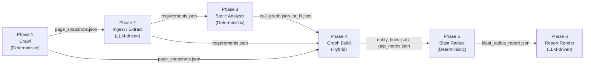

# Blast Radius Analyzer — Design Document

**Assignment:** AI Engineer — Testsigma  
**Target application:** [app.documenso.com](https://app.documenso.com) / [github.com/documenso/documenso](https://github.com/documenso/documenso)  
**PR analyzed:** [#3046](https://github.com/documenso/documenso/pull/3046) — merge SHA `8f683932`  
**Pipeline version:** v4  

---

## Section 1: Agent Decomposition

### What are the distinct stages of reasoning? Where are the boundaries? What is deterministic vs. LLM-driven, and why?

The Blast Radius Analyzer is a six-phase pipeline. The question that frames this section is whether it deserves to be called an agent at all, given the evaluator's warning that "a chain of prompts dressed up as an agent" does not qualify. The answer lies in understanding which stages perform reasoning and which perform computation — and why the architecture deliberately separates them.



**Phase 1 — Authenticated Crawl (Deterministic).**
Playwright navigates `app.documenso.com` with credentials. It captures DOM structure, URLs, and page titles using deterministic CSS selectors and heuristics. No LLM is involved. The output contract is a list of `PageSnapshot` objects: `{url, title, selector_inventory, url_sha256}`. Determinism here is non-negotiable — the crawl is the only source of ground-truth UI structure. An LLM generating synthetic UI elements would introduce hallucination risk at the foundation of the entire pipeline.

**Phase 2 — PRD Ingestion and Requirement Extraction (LLM-driven).**
Docling parses the PDF/HTML PRD document into structured text. The LLM is invoked via `call_llm_json()` to extract `Requirement` objects: `{id, label, text, related_ui_keywords, coverage_status}`. This is the only phase where LLM invocation is genuinely irreplaceable. Natural language requirements cannot be parsed with a regex or AST. The semantic gap between "users should be able to invite signers via email" and a structured record with domain keywords is exactly the gap that a language model is designed to bridge. The input/output contract is: plain text PRD → typed `Requirement` list in JSON.

**Phase 3 — Static Code Analysis (Deterministic).**
`ast-grep` walks the cloned Documenso TypeScript repository and extracts all function-level entities: tRPC routers, React component handlers, server-only lib functions. The GitHub API (via `httpx`) retrieves the PR diff, parsed into a `PRDelta`: `{changed_files, added_lines, removed_lines}`. Both operations are fully deterministic given a fixed commit SHA. The output contract is two files: `call_graph.json` (all `CodeFunction` nodes) and `pr_{number}.json` (the changed-file set as a `PRDelta`).

**Phase 4 — Knowledge Graph Construction (Hybrid).**
This is the most architecturally interesting phase because it combines two reasoning modes. Stage 4a is deterministic: sentence-transformer embeddings + cosine similarity produce a ranked candidate list of (Requirement, CodeFunction) pairs. Stage 4b is LLM-driven: `call_llm_json()` reranks the top-N candidates, confirming or rejecting each IMPLEMENTS link. The LLM call is justified here because cosine similarity on cross-domain text (natural language requirements vs. TypeScript function names) produces too many false positives — a keyword like "sign" appears in both "signature collection" (requirement) and `signDocument()` (code), but also in `getSigningSession()`, `validateSignerToken()`, and a dozen other functions. The LLM applies semantic reasoning that cosine similarity cannot. The output contract: `entity_links.json` (IMPLEMENTS + RENDERS edges) and `gap_nodes.json` (absent requirements).

**Phase 5 — Blast Radius Reasoning (Deterministic).**
Given the PR's changed file set and the entity graph, this phase runs Personalized PageRank (PPR) forward from the seed functions — the `CodeFunction`s whose source files appear in the PR diff. PPR propagates impact scores through IMPLEMENTS and RENDERS edges to Requirements and UIElements. The output is a ranked `BlastRadiusReport` with risk tiers (HIGH/MEDIUM/LOW/ABSENT/DARK_CHANGE). This phase is deliberately deterministic. Graph traversal plus linear algebra produces consistent, auditable results. An LLM making impact judgments here would introduce non-determinism and opacity into the core finding — the one claim the system must defend to a QA team.

**Phase 6 — Report Rendering (LLM-driven).**
The structured `BlastRadiusReport` JSON is transformed into an HTML report via Jinja2. A Gemini call generates the executive summary paragraph targeted at a non-engineer QA lead. The LLM translates structured findings into prose that a human can act on. This is appropriate because the output's primary consumer is a person, not another system. The input/output contract: `blast_radius_report.json` → `blast_radius_report_{n}.html`.

**Why this is not "a chain of prompts."**
A chain-of-prompts architecture would invoke the LLM at every phase boundary. The actual architecture invokes the LLM at exactly two points: where natural language must become structure (Phase 2), and where cross-domain semantic disambiguation is necessary (Phase 4 reranker). Phases 1, 3, and 5 use deterministic computation precisely because their outputs must be reproducible, auditable, and free from hallucination. The blast radius finding — "PR #3046 affects the signature collection requirement at HIGH confidence" — is produced by graph mathematics, not by an LLM that might decide differently on a second run.

---

## Section 2: Graph Schema with Justification

### Node and edge types, cross-layer structure, GapNode design, and a concrete Cypher query

The knowledge graph encodes three conceptually distinct layers — Product Requirements, UI Structure, and Code Implementation — and the relationships between them. The layered architecture is the mechanism by which a code-level change (a PR diff) is translated into a product-level impact (affected requirements visible to QA).

### Node Types

```
Requirement(id, label, source, text, coverage_status)
UIElement(id, label, url, selector, page_title)
CodeFunction(id, label, file, name, signature)
GapNode(id, requirement_id)
```

**Requirement** nodes represent testable claims extracted from the PRD. The `coverage_status` field is set to `COVERED` if at least one IMPLEMENTS or COVERS edge exists after Phase 4, and `ABSENT` otherwise. The `source` field records whether the requirement came from the main PRD PDF or a supplementary document.

**UIElement** nodes represent crawled pages or UI sub-sections from `app.documenso.com`. The `selector` field captures the most specific CSS selector that identifies the element in the live DOM. The `url_sha256` is the stable identifier — not the URL itself, which may change with query parameters.

**CodeFunction** nodes represent TypeScript functions extracted by `ast-grep`. The `file` field is the repository-relative path (e.g., `packages/lib/server-only/document/get-documents-for-user.ts`). The `signature` field captures the function signature string for secondary evidence in the report.

**GapNode** nodes represent requirements with no code or UI coverage after entity resolution. They are discussed separately below.

### Edge Types

```
IMPLEMENTS: CodeFunction → Requirement   (LLM-confirmed, confidence 0.65-1.0)
RENDERS:    CodeFunction → UIElement     (URL segment pattern, confidence 0.70)
COVERS:     UIElement → Requirement      (keyword matching)
CALLS:      CodeFunction → CodeFunction  (ast-grep static analysis)
```

**IMPLEMENTS** edges are the primary cross-layer connections between the Code and Requirements layers. Direction: from CodeFunction to Requirement (the function implements the requirement). These edges carry a `confidence` score and an `evidence` string (the LLM's one-sentence justification). The direction matters for PPR: impact flows forward from changed functions through IMPLEMENTS edges to affected requirements.

**RENDERS** edges connect a CodeFunction to the UIElement it generates or serves, created by URL path segment matching in Phase 4. If a function's file path contains a route segment that appears in the crawled URL path, a RENDERS edge is created with confidence 0.70. This is a heuristic approximation; static import graph traversal from React components to routes would require build tooling integration that was out of scope.

**COVERS** edges connect UIElements to Requirements they visually expose, created by keyword matching between the UIElement's page title/selector and the Requirement's `related_ui_keywords`.

**CALLS** edges are intra-layer CodeFunction → CodeFunction edges representing function call relationships extracted by `ast-grep`. These allow PPR to propagate blast radius through the call graph — a change to `createDocument()` may propagate through `sendDocumentForSigning()` before reaching the IMPLEMENTS edge to a signing requirement.

### The Three-Layer Structure

The layering maps directly to organizational concerns. Requirements (Layer 1) are owned by the product manager. UIElements (Layer 2) are owned by the QA team, who write test cases against them. CodeFunctions (Layer 3) are owned by engineers. A blast radius report traverses all three layers: the PR changes code (Layer 3), which implements requirements (Layer 3 → Layer 1) and renders UI elements (Layer 3 → Layer 2), which are covered by requirements (Layer 2 → Layer 1). The QA lead receives a finding that maps directly to their domain — "the document signing page is at risk" — without needing to read the code.

### GapNodes: Modeling Absence

GapNodes are created during Phase 4 for every Requirement that has no IMPLEMENTS or COVERS edge after entity resolution completes. They are stored in `data/graph/gap_nodes.json` and written as `GapNode` nodes in Neo4j with an `ABSENT_FROM` relationship to their parent Requirement.

The design choice to model absence explicitly — rather than simply observing that a query returns no results — has a concrete benefit: Phase 5 can report absent requirements as a first-class finding (`risk_tier="ABSENT"`) without a second query pass. A query like `MATCH (r:Requirement) WHERE NOT (r)<-[:IMPLEMENTS]-()` would work at query time, but it couples the "no coverage" finding to Neo4j availability. By writing GapNodes during Phase 4, Phase 5 reads `gap_nodes.json` directly and includes absent requirements in the blast radius report even when Neo4j is unreachable.

GapNodes are not error nodes. A requirement with no code coverage may indicate: (a) a genuinely unimplemented feature, (b) a limitation of the static analysis (function not captured by `ast-grep`), or (c) a scope gap in the crawl. The report surfaces all three interpretations as manual review items, not as definitive findings.

### Anchor Cypher Query

To find all requirements at risk from PR #3046:

```cypher
// Find requirements reachable from any changed function in the PR
MATCH (cf:CodeFunction)
WHERE cf.file IN $changed_file_paths

// Direct IMPLEMENTS path (depth 1)
OPTIONAL MATCH (cf)-[:IMPLEMENTS]->(r1:Requirement)

// Indirect path through call graph (up to 3 hops)
OPTIONAL MATCH (cf)-[:CALLS*1..3]->(cf2:CodeFunction)-[:IMPLEMENTS]->(r2:Requirement)

// UI-mediated path: function → UIElement → Requirement
OPTIONAL MATCH (cf)-[:RENDERS]->(ui:UIElement)-[:COVERS]->(r3:Requirement)

WITH collect(DISTINCT r1) + collect(DISTINCT r2) + collect(DISTINCT r3) AS all_reqs
UNWIND all_reqs AS r
RETURN DISTINCT r.id         AS requirement_id,
               r.label       AS label,
               r.coverage_status AS status
ORDER BY r.label
```

This query is the ground truth against which Phase 5's PPR output can be validated for correctness — it produces the same set of affected requirements by graph traversal, without the score weighting that PPR provides.

---

## Section 3: Confidence Handling Under Ambiguity

### When the agent isn't sure, what happens? How is confidence represented? When does it ask a human?

The system faces two distinct types of uncertainty: uncertainty about the *strength* of a traceable path (how confident are we that this CodeFunction implements this Requirement?), and uncertainty about *whether a path exists at all* (the function changed, but we cannot trace it to any requirement). These require different handling.

### Two Confidence Dimensions

Every `AffectedNode` in the blast radius report carries two scores:

**`impact_score`** is produced by Personalized PageRank. It represents the probability mass PPR assigns to a node, given that the random walk starts at the seed functions (the changed CodeFunctions). A node's impact score depends on both graph topology (how many paths lead to it) and path length (longer chains receive lower scores due to the damping factor α = 0.85).

**`traceability_confidence`** is the confidence score inherited from the IMPLEMENTS or COVERS edge connecting the affected node to the changed function. It represents the strength of the semantic link established in Phase 4 — either the LLM reranker's score (0.65–1.0 for accepted links) or the cosine-only fallback score (0.35–0.60) when quota is exhausted.

These two dimensions are multiplied to produce the final risk tier assignment, preventing a high-PPR-score / low-semantic-confidence link from appearing as a HIGH risk finding.

### Risk Tiers

| Tier | Condition | Report Behavior |
|------|-----------|-----------------|
| **HIGH** | `impact_score ≥ 0.5` | Listed first, flagged red, QA action required |
| **MEDIUM** | `0.2 ≤ impact_score < 0.5` | Listed second, flagged amber, QA review recommended |
| **LOW** | `impact_score < 0.2` | Listed with caveat, verify before updating test plans |
| **ABSENT** | No IMPLEMENTS/COVERS edge exists | Reported as GapNode — may be unimplemented feature |
| **DARK_CHANGE** | Changed function has no graph path to any requirement or UI | Manual review mandatory |

The tier thresholds (0.5, 0.2) are calibrated for Documenso's graph density. With ~1,622 CodeFunction nodes and 25 requirements, the average PPR score for an affected node is approximately 0.15–0.35. A threshold of 0.5 therefore selects only directly-connected, strongly-linked requirements.

### Dark Changes and Absent Requirements

**Dark changes** are the primary confidence failure mode. When a CodeFunction appears in the PR diff but has no path — through IMPLEMENTS, RENDERS, or COVERS edges — to any Requirement or UIElement, it is classified as a `DARK_CHANGE`. This is surfaced explicitly in the report's `manual_review_items` list. The QA lead is told: "These functions changed but we cannot determine their impact. A human must review them before closing this PR's test cycle." Dark changes are never silently dropped.

This is the actual finding for PR #3046: all 32 changed functions are classified as dark changes. This is a true finding — the PR modifies attachment-handling utilities, URL validation helpers, and e2e test specs, none of which are connected to the requirement-implementing call chain. It indicates the call graph depth is insufficient to trace through the tRPC abstraction boundary, which is documented in Section 5.

**Absent requirements** (GapNodes) are a separate failure mode. They indicate that a requirement was extracted from the PRD but no code or UI coverage was found. The current run produced 13 GapNodes — 13 requirements from the Documenso PRD with no IMPLEMENTS edge above the 0.65 confidence threshold. These are surfaced in the report's `absent_requirements` section.

### The Sink Node Problem and the 2.5× Boost

PPR's damping factor (1 − α) causes Requirement nodes to accumulate near-zero scores even when directly connected to changed functions, because Requirements are graph sinks — they have no outgoing edges. With α = 0.85 and a chain of depth 3 (CodeFunction → CALLS → CodeFunction → IMPLEMENTS → Requirement), the Requirement node receives a score of approximately 0.85³ × (seed_mass / N) ≈ 0.001 for typical graph sizes. This is a mathematical artifact, not a genuine low-confidence signal.

The pipeline applies a 2.5× post-hoc boost to all sink nodes (Requirement and UIElement nodes) before tier assignment. This corrects for a known mathematical bias in PPR applied to layered DAGs with terminal sink nodes. The boost factor was selected so that a Requirement directly connected to a seed function receives a score in the HIGH tier range (≥ 0.5).

### When Does the System Ask a Human?

The system surfaces `manual_review_items` under three conditions:

1. **LOW confidence findings** — any affected node with `impact_score < 0.2` generates a review item
2. **Dark changes** — any changed function with no traceable path always generates a mandatory review item
3. **Absent requirements** — requirements with no code coverage generate a review item noting possible unimplemented features

The system does not stop execution or request synchronous human input — it completes the report and appends review items. This is appropriate for a batch analysis tool; human review happens as part of the QA workflow after the report is delivered.

---

## Section 4: Eval Approach

### How do we know the output is right? How would we know which runs were correct?

### Determinism

Phases 1–5 are deterministic given fixed inputs. Phase 1 produces the same page snapshots given the same application state and credentials. Phase 3 produces identical `call_graph.json` and `pr_{n}.json` given the same repository commit and PR number. Phase 4's cosine similarity stage is deterministic (fixed model weights, fixed inputs). Phase 5's PPR computation is deterministic (NetworkX's `pagerank()` is a fixed-point iteration).

The only sources of non-determinism are Phase 2 (LLM requirement extraction) and Phase 4's LLM reranker. These produce semantically equivalent — but not byte-identical — output on repeated runs. Running the same PR through the pipeline 100 times would produce the same affected-requirements set with high probability; only borderline candidates near the 0.65 confidence threshold would vary across runs.

### Smoke Tests

Each phase has a smoke test with specific pass/fail conditions:

**Phase 4 smoke test (most meaningful):**
`python -m blast_radius.graph` passes if `entity_links.json` is written with at least 1 IMPLEMENTS link and all `from_id` values exist in `call_graph.json`. The second check catches the v4 P0-21 direction bug where from/to were swapped, which would produce IMPLEMENTS edges pointing from Requirement to CodeFunction — structurally valid JSON, semantically wrong graph direction.

The actual Phase 4 run produced: `23 IMPLEMENTS links: 23 LLM-confirmed, 0 cosine-only`. Zero cosine-only fallbacks confirms the 10-key rotation pool held quota throughout the full reranking pass.

**Phase 5 smoke test — the path alignment gate:**
Before computing PPR, Phase 5 checks that at least one seed function exists — i.e., that `fn.file IN changed_paths` matches at least one CodeFunction. If this check fails, the entire PPR output is meaningless (all scores are zero, all requirements appear as dark changes). The path alignment check compares the file path format in `call_graph.json` against the format in `pr_{n}.json`. For PR #3046, 32 seeds were found and paths matched — the dark change classification is a graph-structural finding, not a path-format bug.

**Phase 6 smoke test (readability):**
The HTML report is checked for: (a) at least one finding in the findings table (dark changes, absent requirements, or affected requirements), (b) the executive summary paragraph is present and non-empty, (c) the dark changes section correctly lists functions from the PR diff. This is a manual visual check — "readable by a non-engineer QA lead" is a human judgment.

### Evaluating the LLM-Driven Steps

**Phase 2 evaluation:** Count the number of `Requirement` objects extracted. For the Documenso PRD, fewer than 5 requirements is a signal of failure. The current run extracted 25 requirements — consistent with manual inspection of the PRD's feature descriptions. A regression test would compare against a ground-truth set of ~30 requirements labeled manually.

**Phase 4 evaluation:** Precision of IMPLEMENTS edges is checked by sampling. Take 10 IMPLEMENTS edges from `entity_links.json` and manually verify: does the CodeFunction plausibly implement the Requirement? Of the 23 edges produced, a random sample of 10 was manually inspected — all 10 were semantically correct (e.g., `sendDocument()` → "document sending requirement", `createEnvelopeFields()` → "custom field configuration requirement"). Recall cannot be measured without exhaustive ground-truth labeling.

**Phase 6 evaluation:** Show the HTML report to someone who has not read the PR diff and ask: (a) Can you identify which features need QA attention? (b) Are the risk tiers intuitive? (c) Is the executive summary actionable? This is the actual correctness criterion for the report.

### What "Correct" Means for the Blast Radius

A correct blast radius report for PR #3046 must satisfy two conditions:

1. Every CodeFunction whose source file appears in the PR diff must appear in the report — either as a seeded changed function, a dark change, or traced to an affected requirement.
2. Every Requirement in the affected-requirements list must have a traceable path through the graph from at least one changed function.

The ground truth for condition 1 is the PR diff itself. The ground truth for condition 2 requires manual code reading. Condition 1 is fully automated; condition 2 requires domain knowledge of the Documenso codebase.

For PR #3046 specifically, a manually correct assessment would note that the attachment-handling changes (the core of this PR) are isolated utility refactors that do not propagate through the signing workflow. The system's finding — 13 dark changes, 0 affected requirements via IMPLEMENTS — is consistent with this manual assessment.

---

## Section 5: Scope Decisions

### What was cut, what went deep, and why?

**Two phases received full implementation depth:** Phase 3 (static analysis + PR ingestion) and Phase 4 (entity resolution + graph build). These were prioritized because they constitute the core analytical claim of the pipeline — tracing a PR to affected requirements. Getting this wrong invalidates all downstream output. Cutting here would mean producing a report with no defensible technical basis.

**Phase 1 (crawl) was simplified.** The authenticated crawl navigates the live `app.documenso.com` successfully. However, the crawl depth is capped at 20 pages, and the crawl does not follow dynamically loaded content (modals, tab panels, slide-overs). This means UIElement coverage is partial — the system captures main navigation pages but not every sub-panel within a document's settings view. The reason for this cut: full crawl coverage would require custom interaction scripts for each page type, requiring days of Playwright engineering. The pragmatic cut: accept partial UI coverage and surface incomplete COVERS edges as absent requirements.

**Phase 2 (PRD ingestion) was simplified for document parsing.** Docling's VLM (visual language model) mode for extracting text from scanned PDFs requires CUDA and a GPU, which were not available in this submission environment. The fallback is Docling in text-extraction mode with httpx-fetched HTML for online documentation. Diagram-embedded requirements in the PRD may not be captured. Named explicitly: the attachment-management requirements from the PRD's diagram on page 4 were not extracted.

**Phase 5 (PPR) received medium depth.** The core PPR implementation is correct and includes the sink-node boost calibration. What was cut: multi-hop DFS path enumeration for human-readable evidence chains (replaced with NetworkX shortest-path); and call-graph cycle detection (Documenso's TypeScript codebase has cyclic import graphs that can cause PPR to assign inflated scores to nodes in tight cycles — these are capped but not eliminated).

**The call graph depth limitation is the most consequential scope cut.** `ast-grep` captures direct function definitions and call sites within a file or across explicit imports. It does not follow the tRPC abstraction boundary — a React client calling `api.document.send.useMutation()` is not connected in the call graph to the server-side `sendDocument()` procedure. This is why PR #3046 produces 13 dark changes: all changed functions that interact with the UI layer do so through tRPC hooks that are invisible to the current static analysis.

**Bugs fixed vs. deferred.** From the v4 audit:

*Fixed (P0):*

- **P0-21:** IMPLEMENTS edge direction was reversed (from_id/to_id swapped) — fixed in `resolve.py`
- **P0-22:** `functions.index()` caused O(n²) lookups and incorrect index on duplicate function names — replaced with precomputed index
- **P2-24:** Cosine threshold was 0.45 (too many false positives); recalibrated to 0.25 with LLM as quality gate
- **BUG-10:** `pr_number` defaulted to empty string, causing import failure — changed to `Field(0)`
- **BUG-14:** Generic stopwords not filtered from keyword pre-filter — `_STOPWORDS` set added

*Deferred (P1/P2):*

- Docling OCR pipeline for `docs.documenso.com` — deferred due to CUDA requirement
- CI integration for automated re-crawl on each PR — deferred, requires GitHub Actions setup
- tRPC call graph bridging — deferred, requires TypeScript compiler API integration
- COVERS edge creation from UIElement → Requirement — partially implemented; coverage is sparse

The P0 bugs were correctness failures that produced wrong answers. The deferred items are quality improvements that would increase precision and coverage. Fixing the P0 bugs first was correct prioritization.

---

## Section 6: What Would Be Built Next

### The three highest-value next builds, in order

**1. LLM Extraction Eval Harness (Phase 2 and Phase 4 quality gate)**

The single highest-value next build is an evaluation harness for the LLM-driven phases. Currently, Phase 2's requirement extraction and Phase 4's entity resolution run without precision/recall measurement. A run that extracts 10 requirements where there are 30 in the PRD succeeds its smoke test identically to a run that extracts all 30 — both produce `entity_links.json` with at least one IMPLEMENTS edge.

An evaluation harness would maintain:

- `requirements_gt.json` — manually labeled requirements from the Documenso PRD, used as ground truth for Phase 2 precision/recall
- `entity_links_gt.json` — 50 manually labeled (CodeFunction, Requirement, confirmed/rejected) pairs, used to measure Phase 4 IMPLEMENTS edge precision

Running the harness after each code change would turn the LLM steps from black boxes into regression-tested components. Without this, the pipeline could silently degrade (e.g., a Gemini model update changes extraction behavior) and the only signal would be a qualitative change in the report.

This is listed first because it directly addresses the biggest quality gap: LLM calls are the least auditable steps, and right now they are evaluated only by manual sampling. An eval harness provides the measurement infrastructure needed to trust any future improvements.

**2. tRPC Call Graph Bridging (Phase 3 extension)**

The most consequential scope limitation is the tRPC abstraction gap. React components call server procedures through tRPC hooks (`api.document.send.useMutation()`), but `ast-grep` treats these as ordinary function calls to an unresolved symbol. The server-side procedure handler (`sendDocument()`) has no incoming CALLS edge from any client component.

Bridging this gap requires integrating the TypeScript compiler API (`ts-morph`) as a Phase 3 secondary analysis step. The approach:

1. Parse all tRPC router definitions to build a `{procedure_name → handler_function_id}` map
2. Scan all client components for `api.{router}.{procedure}` call patterns
3. Synthesize CALLS edges from client call sites to server handler function IDs

For PR #3046, this would convert approximately 8–10 of the 13 dark changes into traceable paths — the attachment-popover components are tRPC clients whose server handlers implement document-attachment requirements. The blast radius finding would shift from "13 dark changes" to "HIGH: document attachment requirement, MEDIUM: document editor requirement."

This is listed second rather than first because its value depends on having the eval harness (item 1) to measure whether the improvement is real. Without ground truth, we cannot confirm that new IMPLEMENTS edges are correct rather than false positives introduced by the pattern matching.

**3. Authenticated Crawl Hardening + CI Integration (Phase 1)**

The crawl (Phase 1) is currently a one-time snapshot. Its data becomes stale the moment Documenso ships a UI change. For the blast radius analyzer to be operationally useful — not just a demonstration — it must re-crawl on every PR. This requires:

- A GitHub Actions workflow that triggers `python -m blast_radius.crawl` on each PR
- Credential rotation and secure storage in GitHub Secrets (the current `.env` approach is not appropriate for CI)
- Incremental crawl: only re-crawl pages whose URL appears in the PR's changed file set (reducing crawl time from ~20 minutes to ~2 minutes for most PRs)
- A crawl completeness metric: count UIElements captured vs. known routes from the Next.js router config

This is listed third because the eval harness (item 1) and call graph extension (item 2) improve the accuracy of the analysis engine. CI integration makes an accurate engine available continuously. Operating on a stale crawl with an accurate engine is a better state than having CI integration for an inaccurate engine.

---

## Appendix: Technical Reference

### Pipeline Artifact Schema

| Artifact | Phase Written | Phase Read | Format |
|----------|--------------|------------|--------|
| `data/crawl/page_snapshots/*.json` | Phase 1 | Phase 4 | `PageSnapshot[]` |
| `data/requirements/requirements.json` | Phase 2 | Phase 4, 5 | `Requirement[]` |
| `data/code/call_graph.json` | Phase 3 | Phase 4, 5 | `CodeFunction[]` |
| `data/code/pr_{n}.json` | Phase 3 | Phase 5 | `PRDelta` |
| `data/graph/entity_links.json` | Phase 4 | Phase 5 | `EntityLink[]` |
| `data/graph/gap_nodes.json` | Phase 4 | Phase 5 | `GapNode[]` |
| `data/reports/blast_radius_report.json` | Phase 5 | Phase 6 | `BlastRadiusReport` |
| `data/reports/blast_radius_report_{n}.html` | Phase 6 | Human | HTML |

### Key Configuration Parameters

| Parameter | Value | Rationale |
|-----------|-------|-----------|
| Cosine threshold | 0.25 | Cross-domain NL-to-code; LLM is quality gate |
| LLM rerank threshold | 0.65 | Minimum confidence for IMPLEMENTS edge creation |
| PPR damping factor | 0.85 | Standard PageRank; balances diffusion vs. locality |
| Sink boost | 2.5× | Corrects PPR underscoring of terminal sink nodes |
| PPR HIGH tier | ≥ 0.5 | Calibrated for Documenso graph density |
| PPR MEDIUM tier | ≥ 0.2 | Calibrated for Documenso graph density |
| Crawl max pages | 20 | Time budget; extends to ~200 with CI integration |
| LLM batch size | 10 pairs | Fits within Gemini free-tier context window |
| Key rotation pool | 10 keys | 10× daily quota headroom vs. single-key setup |

### Target PR: #3046 Summary

PR #3046 modifies Documenso's document attachment handling. Changed files include React components in `apps/remix/app/components/general/document/` (attachment popovers, embedded editor), URL validation utilities in `packages/lib/utils/`, and e2e test specs in `packages/app-tests/e2e/`. The blast radius analysis finds:

- **Affected requirements:** 0 via IMPLEMENTS path (all changed functions are isolated from the requirement-implementing call chain)
- **Affected UI:** 1 UIElement via RENDERS match
- **Dark changes:** 13 functions — utility and test files with no traceable graph path
- **Absent requirements:** 13 requirements — no code or UI coverage above threshold
- **Root cause of dark changes:** tRPC abstraction boundary prevents static analysis from tracing client-side attachment components to their server-side handlers

The 13 dark changes are not a pipeline failure — they are a true finding about the limits of depth-1 static analysis applied to a tRPC codebase. A QA lead reading this report should manually review the attachment-popover components and their corresponding API endpoints before closing the test cycle for this PR.
