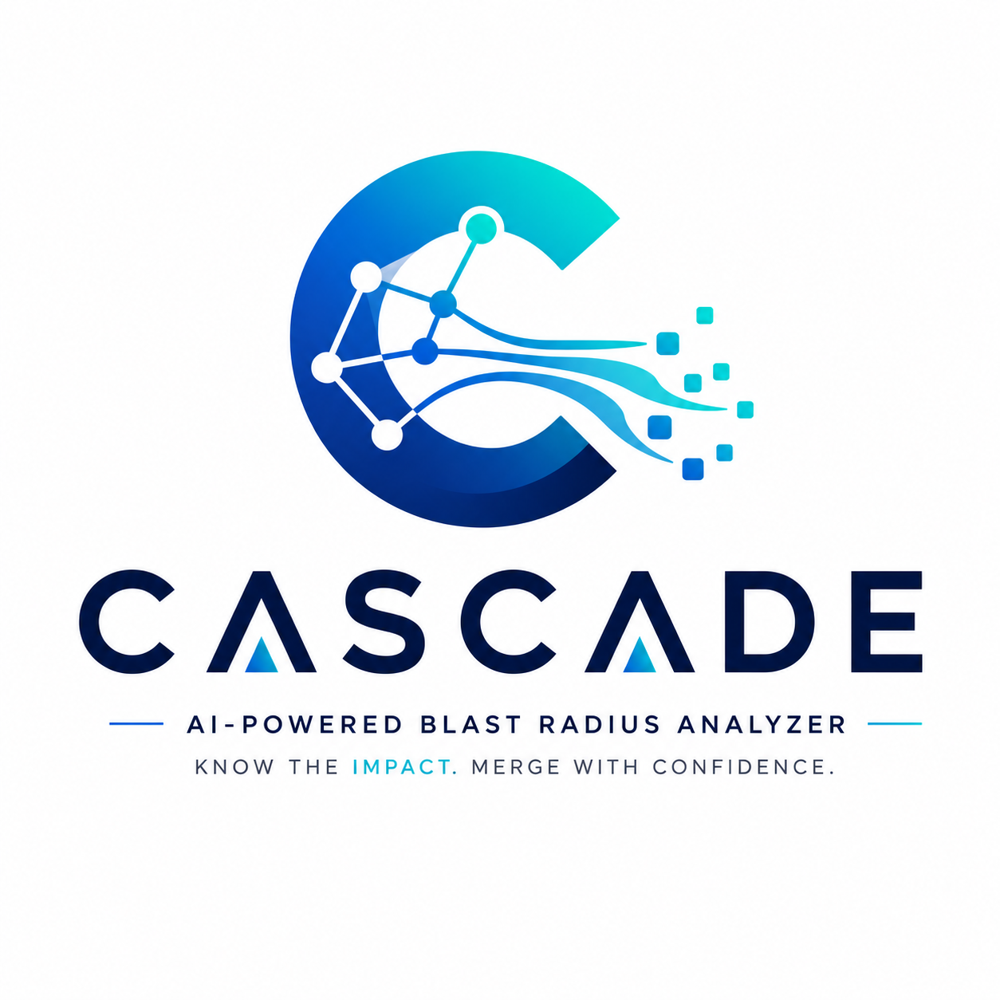

<p align="center">
  
</p>

# CASCADE — Change Analysis for Software Cascade using Dependency Evidence
### *Testsigma AI Engineer Assignment — Submission Package*

> *“Understand every consequence before every merge.”*

**Candidate:** Harsh Vardhan (*B.Tech CSE - Data Science & Analytics, IIIT Nagpur*)  
**Role:** AI Engineer — Testsigma  
**Target Application:** [app.documenso.com](https://app.documenso.com) / [github.com/documenso/documenso](https://github.com/documenso/documenso)  
**Evaluated PR:** [Documenso PR #3046](https://github.com/documenso/documenso/pull/3046) (*fix: tighten permission and validation checks*)  

---

## 📦 Submission Deliverables Index

All four core assignment deliverables specified in Part 3 of the brief (`docs/assignment/d0_AI Engineer Updated - Assignment.md`) are package-ready in this repository:

| Deliverable | Package Location | Status | Summary |
|---|---|---|---|
| **1. Code Repository & README** | Root repo / [`README.md`](../README.md) | ✅ Complete | Fully runnable 6-phase pipeline, entry point `python run.py <url>`, 34 passing unit tests. |
| **2. Design Document (v2 Streamlined)** | [`submission/design_document_v2.pdf`](design_document_v2.pdf)<br>[`submission/design_document_v2.md`](design_document_v2.md)<br>[`submission/design_document_v2.html`](design_document_v2.html) | ✅ Complete | Streamlined ~10-page edition (~17.5KB MD / 316KB PDF / 350 lines). Details agent decomposition, 3-layer Neo4j schema, GapNode absence modeling, PPR reasoning, and scope decisions with 4 Mermaid diagrams. |
| **3. Sample Blast Radius Report** | [`submission/blast_radius_report_pr3046.pdf`](blast_radius_report_pr3046.pdf)<br>[`submission/blast_radius_report_pr3046.html`](blast_radius_report_pr3046.html)<br>[`submission/blast_radius_report_pr3046.md`](blast_radius_report_pr3046.md) | ✅ Complete | Real report for Documenso PR #3046 formatted for a non-engineer QA lead. Highlights affected pages, 13 dark changes, and 6 absent requirements. |
| **4. Loom Walkthrough Video** | *URL to be attached in submission email* | ⚠️ Pending Recording | 5–10 min video recording walking through prototype execution, Neo4j 3D graph visualizer, and Design Doc. |

---

## 🛠️ System Architecture & Quick Start

### Quick Execution Command

```bash
# 1. Start Neo4j container (one-time setup)
docker compose up -d

# 2. Run blast radius analysis on any Documenso PR URL
python run.py https://github.com/documenso/documenso/pull/3046
```

### Architecture Summary

```
OFFLINE PIPELINE (Graph Construction):
  Phase 1: Autonomous Browser Crawl (Playwright + Fixture Fallback) -> UIElement & UserFlow Nodes
  Phase 2: Product Spec Ingestion (Docling MDX + Gemini) -> Requirement & Gap Nodes
  Phase 3: Static Code Analysis (ast-grep AST Parser) -> CodeFunction Nodes
  Phase 4: Hybrid Entity Resolution (Vector Cosine + Gemini Reranker) -> Neo4j 3-Layer Graph

ONLINE PIPELINE (Per-PR Reasoning):
  GitHub PR URL -> Fetch Diff (REST API) -> Phase 5: Reason Engine (Personalized PageRank) -> Phase 6: Jinja2 + Gemini Prose Summary -> Final Blast Radius Report
```

---

## 🎥 Loom Recording Script & Walkthrough Outline

*(Use this 5-minute script when recording the Loom walkthrough video)*

1. **0:00 – 1:00 | Intro & Executive Overview:**
   - Introduce candidate name and the assignment objective (Blast Radius Analyzer for Documenso PRs).
   - Briefly explain the 3-layer Knowledge Graph (Requirements, UI/UserFlows, Code).

2. **1:00 – 2:30 | Live Prototype Demo:**
   - Show Neo4j running (`docker compose up -d`).
   - Run `python run.py https://github.com/documenso/documenso/pull/3046` in the terminal.
   - Show output generated in `outputs/reports/pr_3046_blast_radius.md`.
   - Highlight key report findings: 1 affected page (`/settings/profile`), 13 dark changes (security utilities), non-engineer QA test checklist.

3. **2:30 – 3:45 | Interactive 3D Graph Explorer:**
   - Open `data/graph_explorer.html` in browser.
   - Pan/zoom through the 2,300+ nodes and 7,400+ cross-layer edges.
   - Show color-coded nodes (Purple = Requirements, Green = UIElements, Amber = CodeFunctions, Red = GapNodes/AbsentRequirements).

4. **3:45 – 5:00 | Design Document & Scope Defense:**
   - Open `submission/design_document.md`.
   - Explain agent decomposition (why graph reasoning is deterministic linear algebra, not prompt chaining).
   - Defend scope cuts (tRPC abstraction boundary, depth-1 AST parsing) and describe the 1-week roadmap.

---

## ✉️ Email Submission Template

```text
To: [Hiring Manager / Recruiter Email]
Subject: Harsh Vardhan — AI Engineer Assignment Submission

Dear Testsigma Engineering Team,

Please find my submission for the AI Engineer Take-Home Assignment below.

- GitHub Repository: https://github.com/The-Harsh-Vardhan/Testsigma
- Loom Walkthrough Video: [INSERT LOOM URL HERE]
- Submission Package Directory: /submission

Key Deliverables:
1. Runnable Code & README: Complete 6-phase pipeline with single entry point `python run.py <pr_url>`.
2. Design Document: /submission/design_document.md (8–12 pages equivalent with architecture diagrams).
3. Sample Blast Radius Report: /submission/blast_radius_report_pr3046.md (Formatted for QA leads).
4. Technical Audit & Roast: /submission/complete_audit_report.md (Detailed architectural evaluation).

Thank you for the opportunity to work on this assignment. I look forward to discussing the design and code with the team!

Best regards,
Harsh Vardhan
```
