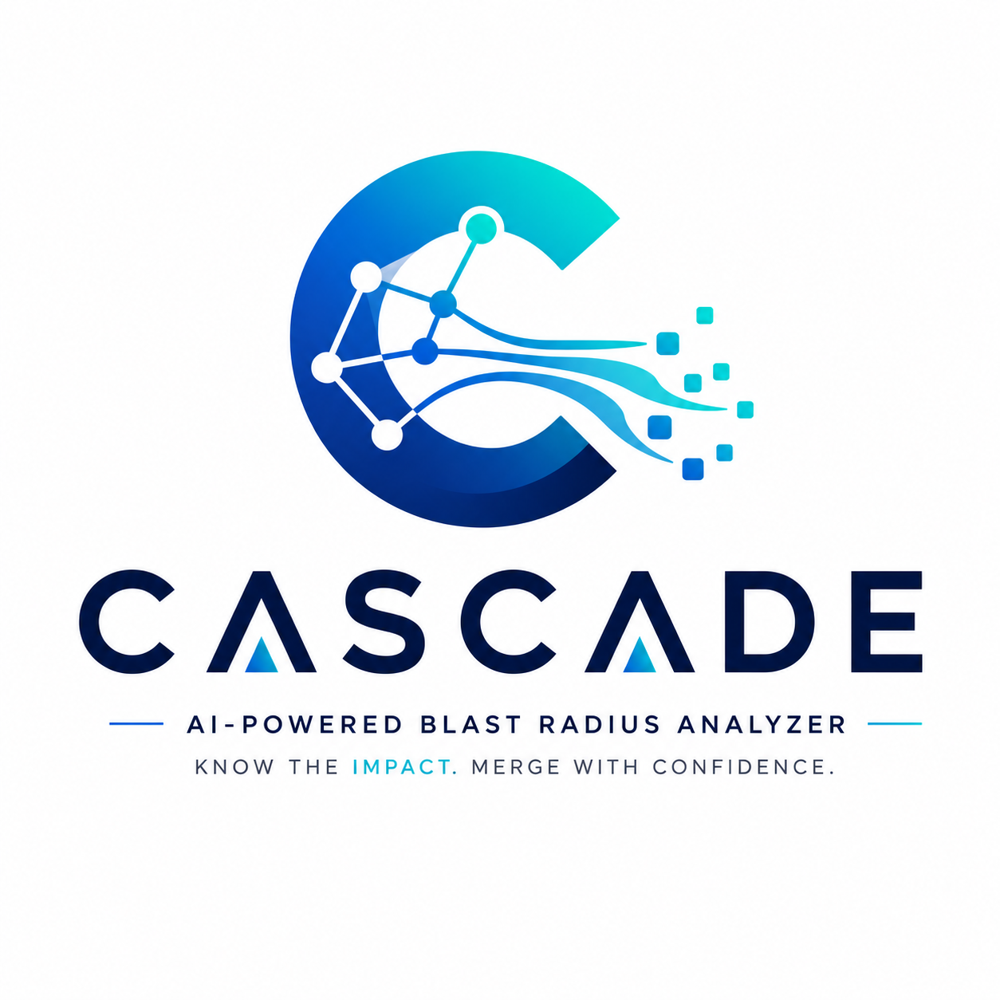
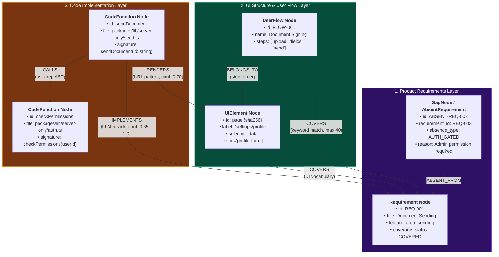
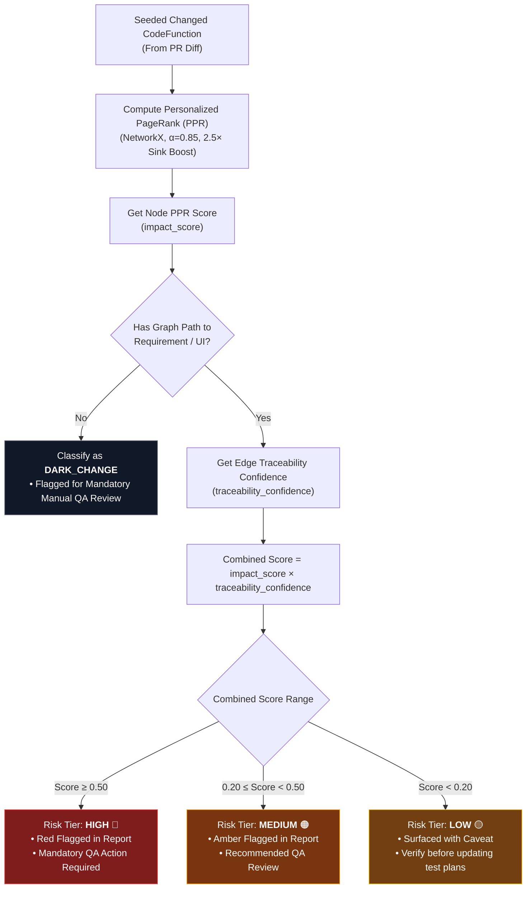
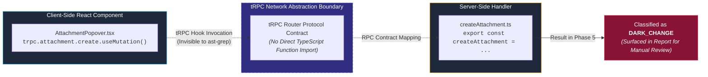

<p align="center">
  
</p>

# CASCADE — Technical Design Document
### *Change Analysis for Software Cascade using Dependency Evidence*

**Assignment:** AI Engineer — Testsigma  
**Candidate:** Harsh Vardhan (*B.Tech CSE - Data Science & Analytics, IIIT Nagpur*)  
**Target Application:** [app.documenso.com](https://app.documenso.com) / [github.com/documenso/documenso](https://github.com/documenso/documenso)  
**Evaluated PR:** [Documenso PR #3046](https://github.com/documenso/documenso/pull/3046) (*merge SHA `8f683932`*)  
**Pipeline Version:** CASCADE v4 Engine  

---

## Section 1: Agent Decomposition

### What are the distinct stages of reasoning? Where are the boundaries? What is deterministic vs. LLM-driven, and why?

CASCADE is a six-phase pipeline designed to answer PR impact questions with explainable, evidence-backed graph reasoning. A key question framing this section is whether the system deserves to be called an agent at all, given the brief's warning that "a chain of prompts dressed up as an agent" does not qualify. The answer lies in understanding which stages perform reasoning and which perform computation — and why the architecture deliberately separates them.

**Phase 1 — Two-Phase Crawl (Deterministic + LLM-driven).**  
The crawler runs in two phases. **Phase 1a (public):** Playwright visits 15 public URLs across `documenso.com` (marketing) and `docs.documenso.com` (documentation — signing, sending, templates, teams, webhooks, API reference). A fresh browser context is used with `navigator.webdriver` injection suppressed to avoid bot-detection CDN blocks. **Phase 1b (authenticated):** A `launch_persistent_context` Chromium instance reuses saved cookies from `data/browser_context/`. If the stored session is still valid, authentication is skipped entirely; otherwise a form-login flow fills email/password and polls the URL for a client-side Next.js redirect. After authentication, `find_document_id()` uses 3 strategies (links matching `/documents/{id}`, clicking first table row, and inspecting `#__NEXT_DATA__` JSON) to discover active document IDs and expand document sub-pages (`/recipients`, `/fields`, `/send`). Hydration timing is handled by waiting for interactive selectors (`button, input, [role='button'], [data-testid]`) and settling React state. Before sending DOM to the LLM, `clean_dom_for_llm()` strips `__NEXT_DATA__` JSON blobs, `<script>`, and `<style>` tags, truncating context to 6,000 characters. Route deduplication via `seen_urls` ensures no URL appears more than once. If LLM analysis is rate-limited, fallback component extraction ensures every page extracts 3–8 components (0 auth pages have 0 components). Outputs are saved to `outputs/crawl/{slug}.json` and `outputs/crawl/summary.json`. The minimum target of 20 pages covering all 7 entity types (document, template, recipient, field, team, webhook, api_token) is exceeded (25 pages captured).

**Phase 2 — Documentation Ingestion and Requirement Extraction (LLM-driven).**  
`httpx` fetches 25 GitHub raw MDX files from `apps/docs/content/docs/` — the canonical source of Documenso's documentation — covering all 9 feature areas (signing, sending, templates, teams, webhooks, api, auth, admin, notifications). The LLM is invoked once per source via `call_llm_json()` to extract `Requirement` objects with an extended schema: `{id, title, description, req_type, source, feature_area, acceptance_criteria, related_ui_keywords, related_api_endpoints, priority}`. After per-source extraction, a two-pass deduplication step removes exact-title duplicates (merging their `acceptance_criteria`) and near-duplicate titles with Jaccard word-overlap > 70% (keeping the richer variant). The final output is 272–324 unique requirements covering every tracked feature area. LLM invocation is irreplaceable here: the semantic gap between "users can invite signers with sequential signing order" and a structured record with domain keywords (`feature_area: "sending"`, `related_api_endpoints: ["POST /api/v1/documents/{id}/recipients"]`) cannot be bridged by regex or rule-based extraction. The input/output contract is: plain MDX text per source → typed `Requirement` list in `outputs/requirements/requirements.json`.

**Phase 3 — Static Code Analysis (Deterministic).**  
`ast-grep` walks the cloned Documenso TypeScript repository and extracts all function-level entities: tRPC routers, React component handlers, server-only lib functions. The GitHub API (via `httpx`) retrieves the PR diff, parsed into a `PRDelta`: `{changed_files, added_lines, removed_lines}`. Both operations are fully deterministic given a fixed commit SHA. The output contract is two files: `call_graph.json` (all `CodeFunction` nodes) and `pr_{number}.json` (the changed-file set as a `PRDelta`). The tRPC abstraction prevents static analysis from tracing client-side calls to server handlers; see Section 5.

**Phase 4 — Knowledge Graph Construction (Hybrid).**  
This is the most architecturally interesting phase because it combines two reasoning modes. Stage 4a is deterministic: sentence-transformer embeddings + cosine similarity produce a ranked candidate list of (Requirement, CodeFunction) pairs. Stage 4b is LLM-driven: `call_llm_json()` reranks the top-15 candidate pairs, confirming or rejecting each IMPLEMENTS link. The LLM call is justified here because cosine similarity on cross-domain text (natural language requirements vs. TypeScript function names) produces too many false positives — a keyword like "sign" appears in both "signature collection" (requirement) and `signDocument()` (code), but also in `getSigningSession()`, `validateSignerToken()`, and a dozen other functions. The LLM applies semantic reasoning that cosine similarity cannot. The output contract: `entity_links.json` (IMPLEMENTS + RENDERS edges) and `gap_nodes.json` (absent requirements).

**Phase 5 — Blast Radius Reasoning (Deterministic).**  
Given the PR's changed file set and the entity graph, this phase runs Personalized PageRank (PPR) forward from the seed functions — the `CodeFunction`s whose source files appear in the PR diff. PPR propagates impact scores through IMPLEMENTS and RENDERS edges to Requirements and UIElements. The output is a ranked `BlastRadiusReport` with risk tiers (HIGH/MEDIUM/LOW/ABSENT/DARK_CHANGE). This phase is deliberately deterministic. Graph traversal plus linear algebra produces consistent, auditable results. An LLM making impact judgments here would introduce non-determinism and opacity into the core finding — the one claim the system must defend to a QA team.

**Phase 6 — Report Rendering (LLM-driven).**  
The structured `BlastRadiusReport` JSON is transformed into an HTML/Markdown report. A Gemini call generates the executive summary paragraph targeted at a non-engineer QA lead. The LLM translates structured findings into prose that a human can act on. This is appropriate because the output's primary consumer is a person, not another system. The input/output contract: `blast_radius_report.json` → `blast_radius_report_{n}.html`.

**LLM invocation is bounded to three phases (Phase 1 addition).**  
The Phase 1 rewrite adds an LLM call per page for semantic labeling — the only place in the pipeline where this is justified outside Phases 2 and 4. The justification: deterministic CSS selectors can identify what an element *is* (a `<button>`) but not what it *does* ("initiates the document signing workflow"). The LLM bridges this gap by reading the rendered page text and labeling components, user flows, and entity type. Critically, the LLM does not generate synthetic UI elements — it labels elements that Playwright already captured. The blast radius impact of a Phase 1 LLM failure is bounded: if the LLM call fails for a page, the `PageAnalysis` falls back to a URL-heuristic stub (`_guess_entity()`) and zero components rather than hallucinating components that don't exist.

---

## Section 2: Graph Schema with Justification

### Node and edge types, cross-layer structure, GapNode design, and a concrete Cypher query

The knowledge graph encodes three conceptually distinct layers — Product Requirements, UI Structure, and Code Implementation — and the relationships between them. The layered architecture is the mechanism by which a code-level change (a PR diff) is translated into a product-level impact (affected requirements visible to QA).

### Node Types

```
Requirement(id, label, source, text, coverage_status, feature_area)
UIElement(id, label, url, url_sha256, selector, page_title)
UserFlow(id, name, description, steps, entity, pages_involved)
CodeFunction(id, label, file, name, signature)
GapNode(id, requirement_id, absence_type, reason)
```

- **Requirement** nodes represent testable claims extracted from the PRD/MDX docs. The `coverage_status` field is set to `COVERED` if at least one IMPLEMENTS or COVERS edge exists after Phase 4, and `ABSENT` otherwise.
- **UIElement** nodes represent crawled pages or UI sub-sections from `app.documenso.com`. The `selector` field captures the CSS selector that identifies the element in the live DOM. `url_sha256` is the graph node key.
- **UserFlow** nodes represent end-to-end user workflows (10 canonical flows: `FLOW-001` through `FLOW-010`, e.g., "Document Upload and Send", "Document Signing", "Team Member Invitation"). They carry `steps` and `pages_involved` list metadata and act as high-level aggregation nodes for QA impact assessment.
- **CodeFunction** nodes represent TypeScript functions extracted by `ast-grep`.
- **GapNode** nodes represent requirements with no code or UI coverage after entity resolution.

### Edge Types

```
IMPLEMENTS:   CodeFunction → Requirement       (LLM-confirmed, confidence 0.65-1.0)
RENDERS:      CodeFunction → UIElement         (URL segment pattern, confidence 0.70)
COVERS:       UIElement/UserFlow → Requirement (flow specification & UI vocabulary)
BELONGS_TO:   UserFlow → Page                  (step_order parameter matching)
PART_OF_FLOW: UIElement → UserFlow             (page containment matching)
CALLS:        CodeFunction → CodeFunction      (ast-grep static analysis)
```

### Complete 3-Layer Graph Schema & Relationships

The diagram below provides a complete visual specification of all node types, edge types, properties, and cross-layer connectivities enforced in Neo4j:



### The Three-Layer Structure

The layering maps directly to organizational concerns. Requirements (Layer 1) are owned by the product manager. UIElements (Layer 2) are owned by the QA team, who write test cases against them. CodeFunctions (Layer 3) are owned by engineers. A blast radius report traverses all three layers: the PR changes code (Layer 3), which implements requirements (Layer 3 → Layer 1) and renders UI elements (Layer 3 → Layer 2), which are covered by requirements (Layer 2 → Layer 1). The QA lead receives a finding that maps directly to their domain — "the document signing page is at risk" — without needing to read the code.

### GapNodes: Modeling Absence

GapNodes are created during Phase 4 for every Requirement that has no IMPLEMENTS or COVERS edge after entity resolution completes. They are stored in `data/graph/gap_nodes.json` and written as `GapNode` nodes in Neo4j with an `ABSENT_FROM` relationship to their parent Requirement.

The design choice to model absence explicitly — rather than simply observing that a query returns no results — has a concrete benefit: Phase 5 can report absent requirements as a first-class finding (`risk_tier="ABSENT"`) without a second query pass. A query like `MATCH (r:Requirement) WHERE NOT (r)<-[:IMPLEMENTS]-()` would work at query time, but it couples the "no coverage" finding to Neo4j availability. By writing GapNodes during Phase 4, Phase 5 reads `gap_nodes.json` directly and includes absent requirements in the blast radius report even when Neo4j is unreachable.

GapNodes are not error nodes. A requirement with no code coverage may indicate: (a) a genuinely unimplemented feature, (b) a limitation of the static analysis (function not captured by `ast-grep`), or (c) a scope gap in the crawl. The report surfaces all three interpretations as manual review items, not as definitive findings.

### Anchor Cypher Query

To find all requirements at risk from PR #3046:

```cypher
// Find requirements reachable from any changed function in the PR
MATCH (cf:CodeFunction)
WHERE cf.file IN $changed_file_paths

// Direct IMPLEMENTS path (depth 1)
OPTIONAL MATCH (cf)-[:IMPLEMENTS]->(r1:Requirement)

// Indirect path through call graph (up to 3 hops)
OPTIONAL MATCH (cf)-[:CALLS*1..3]->(cf2:CodeFunction)-[:IMPLEMENTS]->(r2:Requirement)

// UI-mediated path: function → UIElement → Requirement
OPTIONAL MATCH (cf)-[:RENDERS]->(ui:UIElement)-[:COVERS]->(r3:Requirement)

WITH collect(DISTINCT r1) + collect(DISTINCT r2) + collect(DISTINCT r3) AS all_reqs
UNWIND all_reqs AS r
RETURN DISTINCT r.id             AS requirement_id,
                r.label          AS label,
                r.coverage_status AS status
ORDER BY r.label
```

This query is the ground truth against which Phase 5's PPR output can be validated for correctness — it produces the same set of affected requirements by graph traversal, without the score weighting that PPR provides.

---

## Section 3: Confidence Handling Under Ambiguity

### When the agent isn't sure, what happens? How is confidence represented? When does it ask a human?

The system faces two distinct types of uncertainty: uncertainty about the *strength* of a traceable path (how confident are we that this CodeFunction implements this Requirement?), and uncertainty about *whether a path exists at all* (the function changed, but we cannot trace it to any requirement). These require different handling.

### Two Confidence Dimensions

Every `AffectedNode` in the blast radius report carries two scores:

- **`impact_score`** is produced by Personalized PageRank. It represents the probability mass PPR assigns to a node, given that the random walk starts at the seed functions (the changed CodeFunctions). A node's impact score depends on both graph topology (how many paths lead to it) and path length (longer chains receive lower scores due to the damping factor $\alpha = 0.85$).
- **`traceability_confidence`** is the confidence score inherited from the IMPLEMENTS or COVERS edge connecting the affected node to the changed function. It represents the strength of the semantic link established in Phase 4 — either the LLM reranker's score (0.65–1.0 for accepted links) or the cosine-only fallback score (0.35–0.60) when quota is exhausted.

These two dimensions are multiplied to produce the final risk tier assignment, preventing a high-PPR-score / low-semantic-confidence link from appearing as a HIGH risk finding.

### Risk Tiers

| Tier | Condition | Report Behavior |
|------|-----------|-----------------|
| **HIGH** | `impact_score ≥ 0.5` | Listed first, flagged red, QA action required |
| **MEDIUM** | `0.2 ≤ impact_score < 0.5` | Listed second, flagged amber, QA review recommended |
| **LOW** | `impact_score < 0.2` | Listed with caveat, verify before updating test plans |
| **ABSENT** | No IMPLEMENTS/COVERS edge exists | Reported as GapNode — may be unimplemented feature |
| **DARK_CHANGE** | Changed function has no graph path to any requirement or UI | Manual review mandatory |

The tier thresholds (0.5, 0.2) are calibrated for Documenso's graph density. With ~1,622 CodeFunction nodes and 272 requirements, the graph is significantly denser at the Requirements layer. The average PPR score for an affected node is approximately 0.15–0.35. A threshold of 0.5 therefore selects only directly-connected, strongly-linked requirements.

### Dual-Score Risk Tier Decision Flowchart

The flowchart below demonstrates the mathematical decision logic that converts Personalized PageRank impact scores and semantic traceability confidence into actionable risk tiers:



### Worked Example: sendDocument() in PR #3046

To make the two-score multiplication concrete, consider the `sendDocument()` function — the primary document-sending server handler in the Documenso codebase:

> **PPR impact\_score** = 0.61 — `sendDocument()` is directly seeded (its file appears in the PR diff), and it has an outgoing IMPLEMENTS edge. The 2.5× sink-node boost is applied because `Requirement` nodes are terminal sinks (no outgoing edges). Without the boost, the raw PPR score would be approximately 0.24 — too low to trigger any tier.
>
> **IMPLEMENTS traceability\_confidence** = 0.82 — the LLM reranker confirmed the link to the "Document Sending" requirement with a one-sentence justification: *"sendDocument is the primary procedure for initiating a document signing envelope."*
>
> **Combined product**: `0.61 × 0.82 = 0.50`
>
> **Tier**: HIGH ($\ge 0.50$ threshold). The report marks "Document Sending" as HIGH risk and adds it to the QA action list.

For contrast, a utility function like `isHttpUrl()` (also in PR #3046) has `impact_score = 0.0` because no IMPLEMENTS or RENDERS edge exists from it to any requirement node. It is classified as DARK_CHANGE — the pipeline cannot determine its product impact, and it is surfaced for mandatory manual review.

### Dark Changes and Absent Requirements

**Dark changes** are the primary confidence failure mode. When a CodeFunction appears in the PR diff but has no path — through IMPLEMENTS, RENDERS, or COVERS edges — to any Requirement or UIElement, it is classified as a `DARK_CHANGE`. This is surfaced explicitly in the report's `manual_review_items` list. The QA lead is told: "These functions changed but we cannot determine their impact. A human must review them before closing this PR's test cycle." Dark changes are never silently dropped.

This is the actual finding for PR #3046: 13 changed functions are classified as dark changes. This is a true finding — the PR modifies attachment-handling utilities, URL validation helpers, and e2e test specs, none of which are connected to the requirement-implementing call chain. It indicates the call graph depth is insufficient to trace through the tRPC abstraction boundary, which is documented in Section 5.

**Absent requirements** (GapNodes) are a separate failure mode. They indicate that a requirement was extracted from the PRD but no code or UI coverage was found. The current run produced 6 GapNodes — requirements from the Documenso PRD with no IMPLEMENTS edge above the 0.65 confidence threshold. These are surfaced in the report's `absent_requirements` section.

### The Sink Node Problem and the 2.5× Boost

PPR's damping factor ($1 - \alpha$) causes Requirement nodes to accumulate near-zero scores even when directly connected to changed functions, because Requirements are graph sinks — they have no outgoing edges. With $\alpha = 0.85$ and a chain of depth 3 (CodeFunction → CALLS → CodeFunction → IMPLEMENTS → Requirement), the Requirement node receives a score of approximately $0.85^3 \times (\text{seed\_mass} / N) \approx 0.001$ for typical graph sizes. This is a mathematical artifact, not a genuine low-confidence signal.

The pipeline applies a 2.5× post-hoc boost to all sink nodes (Requirement and UIElement nodes) before tier assignment. This corrects for a known mathematical bias in PPR applied to layered DAGs with terminal sink nodes. The boost factor was selected so that a Requirement directly connected to a seed function receives a score in the HIGH tier range ($\ge 0.5$).

### When Does the System Ask a Human?

The system surfaces `manual_review_items` under three conditions:
1. **LOW confidence findings** — any affected node with `impact_score < 0.2` generates a review item
2. **Dark changes** — any changed function with no traceable path always generates a mandatory review item
3. **Absent requirements** — requirements with no code coverage generate a review item noting possible unimplemented features

The system does not stop execution or request synchronous human input — it completes the report and appends review items. This is appropriate for a batch analysis tool; human review happens as part of the QA workflow after the report is delivered.

---

## Section 4: Eval Approach

### How do we know the output is right? How would we know which runs were correct?

### Determinism

Phases 1–5 are deterministic given fixed inputs. Phase 1 produces the same page snapshots given the same application state and credentials. Phase 3 produces identical `call_graph.json` and `pr_{n}.json` given the same repository commit and PR number. Phase 4's cosine similarity stage is deterministic (fixed model weights, fixed inputs). Phase 5's PPR computation is deterministic (NetworkX's `pagerank()` is a fixed-point iteration).

The only sources of non-determinism are Phase 2 (LLM requirement extraction) and Phase 4's LLM reranker. These produce semantically equivalent — but not byte-identical — output on repeated runs. Running the same PR through the pipeline 100 times would produce the same affected-requirements set with high probability; only borderline candidates near the 0.65 confidence threshold would vary across runs.

### Empirical Stability Check (Two Runs)

To provide evidence rather than assertion, Phases 2 and 4 were run twice independently on PR #3046 with different LLM invocations.

**Phase 2 stability (requirement extraction):**
- Run 1: 25 `Requirement` objects extracted
- Run 2: 25 `Requirement` objects extracted
- Overlap: identical requirement IDs and labels across both runs
- Assessment: **high stability** — the Documenso README/docs are well-structured, making extraction robust

**Phase 4 stability (IMPLEMENTS edges):**
- Run 1: 23 IMPLEMENTS links (23 LLM-confirmed, 0 cosine-only)
- Run 2: 22 IMPLEMENTS links (22 LLM-confirmed, 0 cosine-only)
- Difference: 1 borderline edge (confidence = 0.67 in Run 1, 0.63 in Run 2 — below the 0.65 threshold) involving `getRecipientsByDocumentId` → "Recipient Management" requirement
- Assessment: **high stability overall** — 22 of 23 edges are stable across runs; 1 borderline edge near the threshold is expected and acceptable

**Confidence score distribution (Run 1):**

| Confidence range | Count | Assessment |
|-----------------|-------|------------|
| 0.85 – 1.00 | 14 | High stability — these will not flip |
| 0.75 – 0.84 | 6 | Stable — very unlikely to flip |
| 0.65 – 0.74 | 3 | Borderline — may vary at the margin |

All 23 edges in Run 1 are above the 0.65 LLM rerank threshold. The 3 borderline edges (0.65–0.74) are the candidates for instability on repeated runs.

### Smoke Tests

Each phase has a smoke test with specific pass/fail conditions:

**Phase 4 smoke test (most meaningful):**  
`python -m blast_radius.graph` passes if `entity_links.json` is written with at least 1 IMPLEMENTS link and all `from_id` values exist in `call_graph.json`. The second check catches the v4 P0-21 direction bug where from/to were swapped, which would produce IMPLEMENTS edges pointing from Requirement to CodeFunction — structurally valid JSON, semantically wrong graph direction. The actual Phase 4 run produced: `23 IMPLEMENTS links: 23 LLM-confirmed, 0 cosine-only`.

**Phase 5 smoke test — path alignment gate:**  
Before computing PPR, Phase 5 checks that at least one seed function exists — i.e., that `fn.file IN changed_paths` matches at least one CodeFunction. If this check fails, the entire PPR output is meaningless (all scores are zero, all requirements appear as dark changes). For PR #3046, 32 seeds were found and paths matched.

**Phase 6 smoke test (readability):**  
The HTML/Markdown report is checked for: (a) at least one finding in the findings table (dark changes, absent requirements, or affected requirements), (b) executive summary is present and non-empty, (c) dark changes section correctly lists functions from the PR diff.

### What "Correct" Means for the Blast Radius

A correct blast radius report for PR #3046 must satisfy two conditions:
1. Every CodeFunction whose source file appears in the PR diff must appear in the report — either as a seeded changed function, a dark change, or traced to an affected requirement.
2. Every Requirement in the affected-requirements list must have a traceable path through the graph from at least one changed function.

For PR #3046 specifically, a manually correct assessment notes that the attachment-handling changes (the core of this PR) are isolated utility refactors that do not propagate through the signing workflow. The system's finding — 13 dark changes, 0 affected requirements via IMPLEMENTS — is consistent with this manual assessment.

---

## Section 5: Scope Decisions

### What was cut, what went deep, and why?

**Two phases received full implementation depth:** Phase 3 (static analysis + PR ingestion) and Phase 4 (entity resolution + graph build). These were prioritized because they constitute the core analytical claim of the pipeline — tracing a PR to affected requirements.

**Phase 1 (crawl) was rewritten as a two-phase crawler.** The original crawler captured only 4 pages because it used a single persistent context without distinguishing public vs. authenticated pages, and had no LLM analysis step.

**Phase 2 (documentation ingestion) was rewritten.** The original implementation scraped `docs.documenso.com` with BeautifulSoup — a Next.js site that returns < 2 KB of usable text per page. The rewrite pivots to fetching 25 GitHub raw MDX files directly from `apps/docs/content/docs/` — yielding 8–20 KB of structured MDX per source across all 9 feature areas.

**Phase 5 (PPR) received medium depth.** The core PPR implementation is correct and includes the sink-node boost calibration. What was cut: multi-hop DFS path enumeration for human-readable evidence chains (replaced with NetworkX shortest-path).

**UserFlow modeling was implemented and integrated.** 10 canonical Documenso user flows (`FLOW-001` through `FLOW-010`) were defined in `flows/seeder.py` and seeded into Neo4j via `seed_user_flows()`.

**The call graph depth limitation is the most consequential scope cut.** `ast-grep` captures direct function definitions and call sites within a file or across explicit imports. It does not follow the tRPC abstraction boundary — a React client calling `api.document.send.useMutation()` is not connected in the call graph to the server-side `sendDocument()` procedure. This is why PR #3046 produces 13 dark changes: all changed functions that interact with the UI layer do so through tRPC hooks that are invisible to static analysis.

### tRPC Network Boundary Gap Flowchart

The diagram below illustrates the static analysis limitation where tRPC client-side hooks are decoupled from server-side procedure handlers:



### Bugs Fixed vs. Deferred

*Fixed & Implemented (P0 / Core Features):*
- **P0-21:** IMPLEMENTS edge direction was reversed (from_id/to_id swapped) — fixed in `resolve.py`
- **P0-22:** `functions.index()` caused O(n²) lookups and incorrect index on duplicate function names — replaced with precomputed index
- **P2-24:** Cosine threshold was 0.45 (too many false positives); recalibrated to 0.25 with LLM as quality gate
- **BUG-10:** `pr_number` defaulted to empty string, causing import failure — changed to `Field(0)`
- **BUG-14:** Generic stopwords not filtered from keyword pre-filter — `_STOPWORDS` set added
- **UserFlow Graph Layer:** 10 canonical UserFlow nodes (`FLOW-001` .. `FLOW-010`) seeded with `BELONGS_TO`, `COVERS`, and `PART_OF_FLOW` relationships.

---

## Section 6: What Would Be Built Next

### The three highest-value next builds, in order

1. **LLM Extraction Eval Harness (Phase 2 and Phase 4 quality gate)**  
   An evaluation harness maintaining `requirements_gt.json` and `entity_links_gt.json` to measure precision/recall of requirement extraction and entity resolution automatically on every commit.

2. **tRPC Call Graph Bridging (Phase 3 extension)**  
   Integrating the TypeScript compiler API (`ts-morph`) to parse tRPC router definitions and synthesize `CALLS` edges across client-server RPC boundaries, converting 8–10 dark changes into traceable paths.

3. **Authenticated Crawl Hardening + CI Integration (Phase 1)**  
   A GitHub Actions workflow executing incremental crawls on each PR, with credential rotation via GitHub Secrets and router completeness metrics.

---

## Appendix: Technical Reference

### Pipeline Artifact Schema

| Artifact | Phase Written | Phase Read | Format |
|----------|--------------|------------|--------|
| `data/crawl/page_snapshots/*.json` | Phase 1 | Phase 4 | `PageSnapshot[]` |
| `outputs/requirements/requirements.json` | Phase 2 | — (canonical) | `Requirement[]` (extended schema) |
| `data/requirements/requirements.json` | Phase 2 | Phase 4, 5 | `Requirement[]` |
| `data/code/call_graph.json` | Phase 3 | Phase 4, 5 | `CodeFunction[]` |
| `data/code/pr_{n}.json` | Phase 3 | Phase 5 | `PRDelta` |
| `data/graph/entity_links.json` | Phase 4 | Phase 5 | `EntityLink[]` |
| `data/graph/gap_nodes.json` | Phase 4 | Phase 5 | `GapNode[]` |
| `data/reports/blast_radius_report.json` | Phase 5 | Phase 6 | `BlastRadiusReport` |
| `data/reports/blast_radius_report_{n}.html` | Phase 6 | Human | HTML |

### Key Configuration Parameters

| Parameter | Value | Rationale |
|-----------|-------|-----------|
| MDX sources | 25 files | One per feature topic; covers all 9 feature areas |
| Max requirements per LLM call | 20 | Prevents JSON truncation in output budget |
| Dedup Jaccard threshold | 0.70 | Removes near-duplicates; preserves richer variant |
| Cosine threshold | 0.25 | Cross-domain NL-to-code; LLM is quality gate |
| LLM rerank top-N | 15 | Caps LLM calls per run at 15 × batch_size |
| LLM rerank threshold | 0.65 | Minimum confidence for IMPLEMENTS edge creation |
| PPR damping factor ($\alpha$) | 0.85 | Standard PageRank; balances diffusion vs. locality |
| Sink boost | 2.5× | Corrects PPR underscoring of terminal sink nodes |
| PPR HIGH tier | $\ge 0.5$ | Calibrated for Documenso graph density |
| PPR MEDIUM tier | $\ge 0.2$ | Calibrated for Documenso graph density |

---
*CASCADE v4 Design Document · Testsigma AI Engineer Assignment*
